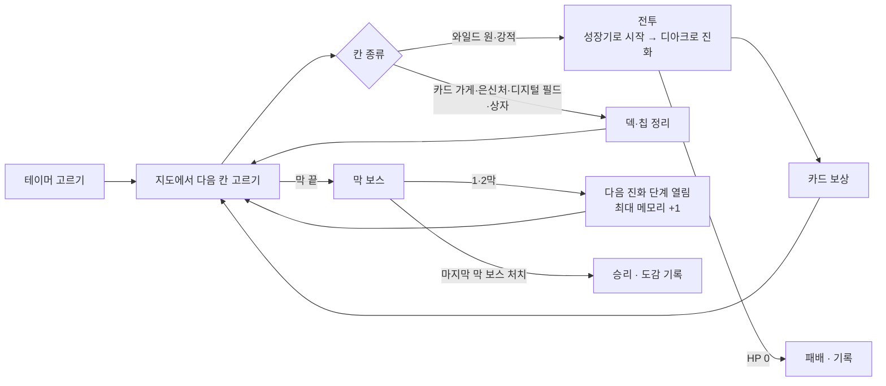
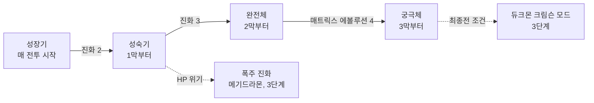

# 01. 기획 (Game Design)

> 상태: **확정 v1.0** (2026-11-13). 초안을 검토해 규칙의 빈틈을 고쳤습니다 (12절).
> 이 문서는 "무엇을, 왜 만드는가"를 적습니다. **정확한 규칙과 수치는 [02_RULES_SPEC.md](02_RULES_SPEC.md)가 기준**이고, 두 문서가 다르면 02를 따릅니다.

## 0. 정한 것

| 항목 | 결정 |
| :--- | :--- |
| 제목 | **디지몬 테이머즈: 블루 카드** |
| 원작 | 디지몬 테이머즈 |
| 주인공 | 원작 테이머 (파트너와 짝) |
| 첫 플랫폼 | 모바일 먼저 (세로 화면, 한 손 조작) |
| 개발 방식 | TypeScript 웹 앱 + Capacitor APK ([03](03_ARCHITECTURE.md)) |
| 한 판 길이 | 20~30분 (3막, 막마다 지도 7행 + 보스) |
| 그림 | 새 도트 (처음엔 자리표시 그림으로 시작) |
| 이름 | 한국 방영판 이름 (4절 이름표) |
| 공개 범위 | GitHub 공개 저장소, 라이선스 없음 (All rights reserved) |
| 진화 방식 | 덱 카드가 아니라 **디아크 행동** (메모리를 내고 언제든 진화) |

## 1. 한 줄 컨셉

**테이머가 되어 카드를 긁어(카드 슬래시) 파트너 디지몬을 싸움 중에 진화시키며, 현실 세계와 디지털 월드를 3막에 걸쳐 지나가는 모바일 덱빌딩 로그라이크.**

- 기본 틀은 슬더슬류입니다: 분기 지도, 턴제 카드 전투, 전투 후 카드 보상, 유물, 판마다 처음부터.
- 테이머즈를 고른 이유: 원작에서 **카드가 곧 싸우는 방법**입니다. 테이머가 카드를 디아크에 긁으면 파트너가 그 힘을 얻습니다. "덱 = 테이머의 카드 컬렉션"이 이야기와 그대로 맞습니다.

## 2. 이 게임만의 재미 (설계 기둥)

1. **싸움 중 진화.** 파트너는 매 전투를 성장기로 시작합니다. 메모리를 내고 진화하면 임시 HP와 공격력이 오르고 그 형태의 **필살기 카드**가 손에 들어옵니다. "지금 카드를 낼까, 진화에 쓸까"가 매 턴의 고민입니다.
2. **메모리 당겨쓰기.** 메모리가 모자라도 3까지 더 쓸 수 있습니다. 대신 적이 다음 공격에서 강해집니다. 디지몬 카드 게임의 메모리 줄다리기를 1인용으로 옮겼습니다.
3. **속성 상성.** 백신 > 바이러스 > 데이터 > 백신. 세 파트너가 속성을 하나씩 맡아, 같은 적도 테이머에 따라 다르게 느껴집니다.
4. **테이머 특성.** 같은 카드라도 누구로 하느냐에 따라 쓰는 법이 달라집니다.
5. **매트릭스 에볼루션.** 3막에서 테이머와 파트너가 하나가 됩니다. 전투 규칙 자체가 바뀝니다 (3단계에서 구현).

구현하다 판단이 필요하면 이 다섯 가지를 살리는 쪽으로 고릅니다.

| 게임 | 성장 단위 | 이 게임과 다른 점 |
| :--- | :--- | :--- |
| Slay the Spire | 캐릭터 고정, 덱만 성장 | 이 게임은 전투마다 파트너가 진화해 올라감 |
| Decktamer | 몬스터를 잡아 파티·덱에 추가 | 이 게임은 한 마리를 깊게 키움 |
| 디지몬 카드 게임 (TCG) | 대전, 덱은 미리 짬 | 판 중에 덱을 만들고 적은 PvE |

## 3. 주인공, 이야기, 막 구성

### 3-1. 테이머
| 테이머 | 파트너 (속성) | 테이머 특성 | 플레이 성격 | 들어가는 단계 |
| :--- | :--- | :--- | :--- | :--- |
| 오유민 | 길몬 (바이러스) | **직접 그린 카드**: 판 시작에 일반 카드 3장 중 1장을 강화된 상태로 얻음 | 강한 한 방, 폭주 진화 위험 | 0단계 |
| 은세나 | 레나몬 (데이터) | **카드 배틀 실력자**: 매 턴 처음 내는 카드 메모리 -1 | 카드 여러 장 이어 내기 | 2단계 |
| 곽소룡 | 테리어몬 (백신) | **침착함**: 매 턴 시작에 실드 +3 | 실드, 여러 번 때리기 | 2단계 |
| 다영·진 (해금) | 임프몬 (바이러스) | **두 사람의 카드**: 매 턴 손패를 두 묶음으로 뽑아 한 묶음을 고름 | 바로 궁극체, 진화 비용 큼 | 3단계 |

- 다른 원작 인물(황주연, 강재호, 이성우, 동글몬, 히프노스 사람들)은 이벤트와 "동료 카드"로 나옵니다 (2단계).

### 3-2. 이야기
- 원작 사건을 **무대로 쓰되, 장면은 짧게 새로 씁니다.** 원작 대사·장면을 그대로 옮기지 않습니다.
- 보여 주는 방식: 막 시작 글 2~3줄, 지도의 "디지털 필드" 이벤트, 테이머마다 다른 엔딩 한 장면.

### 3-3. 막 구성
| 막 | 무대 | 적 | 진화할 수 있는 최고 단계 | 최대 메모리 | 보스 |
| :---: | :--- | :--- | :--- | :---: | :--- |
| 1막 | 현실 세계 — 도시에 나타난 와일드 원 | 와일드 원 | 성숙기 | 3 | 데바 (미히라몬) |
| 2막 | 디지털 월드 | 데바, 디지털 월드 주민 | 완전체 | 4 | 주작몬 |
| 3막 | 다시 현실 — 디 리퍼 침공 | 디 리퍼 에이전트 | 궁극체 (매트릭스 에볼루션) | 5 | 디 리퍼 |

- 한 판은 전투 약 13~14번(막마다 일반·강적 3~4번 + 보스)입니다. 전투 하나를 3~5턴, 약 2분으로 맞추면 20~30분이 됩니다.

| 지도 칸 | 테이머즈식 이름 | 하는 일 |
| :--- | :--- | :--- |
| 전투 | 와일드 원 출현 | 일반 전투 |
| 강적 | 강한 와일드 원 / 데바 | 강한 전투, 디아크 칩 보상 |
| 상점 | 카드 가게 | 카드·칩 사기, 카드 지우기 |
| 휴식 | 은신처 | HP 회복 또는 카드 강화 |
| 이벤트 | 디지털 필드 | 원작 인물과 선택지 |
| 보물 | 블루 카드 상자 | 디아크 칩 |
| 보스 | 막 보스 | 막 끝, 다음 진화 단계 열림 |

## 4. 한국 방영판 이름표

[나무위키](https://namu.wiki/w/%EB%94%94%EC%A7%80%EB%AA%AC%20%ED%85%8C%EC%9D%B4%EB%A8%B8%EC%A6%88) 본문과 회차 제목 기준 (2026-11-13 확인). 게임 안 표기는 이 표를 따릅니다. 코드의 id는 영문 이름을 씁니다.

| 영문 id | 일본판 | 한국 방영판 (게임 표기) |
| :--- | :--- | :--- |
| `takato` | 마츠다 타카토 | 오유민 |
| `rika` | 마키노 루키 | 은세나 |
| `henry` | 리 젠랴 | 곽소룡 |
| `ai_mako` | 아이 · 마코토 | 다영 · 진 |
| — | 카토 쥬리 / 시오다 히로카즈 / 키타가와 켄타 | 황주연 / 강재호 / 이성우 |
| `calumon` | 쿠루몬 | 동글몬 |
| `guilmon` → `growlmon` → `wargrowlmon` → `gallantmon` | 길몬 → 그라우몬 → 메가로그라우몬 → 듀크몬 | 같음 |
| `megidramon` | 메기드라몬 | 메기드라몬 |
| `renamon` → `kyubimon` → `taomon` → `sakuyamon` | 레나몬 → 큐우비몬 → 타오몬 → 사쿠야몬 | 레나몬 → **구미호몬** → **도사몬** → **샤크라몬** |
| `terriermon` → `gargomon` → `rapidmon` → `megagargomon` | 테리어몬 → 가르고몬 → 래피드몬 → 세인트가르고몬 | 테리어몬 → **가고몬** → 래피드몬 → **세인트가고몬** |
| `impmon` → `beelzemon` | 임프몬 → 베르제브몬 | 임프몬 → **베르몬** |
| — | 데바, 디 리퍼, 히프노스, 디아크 | 같음 |
| — | 매트릭스 진화 | **매트릭스 에볼루션** |
| — | 블루 카드 | 게임에서는 제목에 맞춰 **블루 카드** (방영판은 "파란 카드") |

**아직 확인하지 못한 이름** (지금은 일본판 이름을 한글로 적어 씁니다. 확인되면 `src/data`의 `name`만 고칩니다):
- 데바 12체와 와일드 원(적 디지몬)의 한국 방영판 이름
- 기술 이름 (파이어 볼, 엑조스트 플레임 등)
- 다영·진 중 누가 아이이고 누가 마코토인지

## 5. 핵심 루프

## 6. 전투 (개요)

정확한 순서와 공식은 [02 3절](02_RULES_SPEC.md)에 있습니다.

- 내 쪽은 파트너 1마리(HP), 적은 1~3마리.
- 매 턴 손패 5장, 메모리 3(막이 오르면 4, 5). 카드를 끌어 올려 긁습니다. 턴이 끝나면 손패는 버림 더미로 갑니다.
- 적은 다음 행동(인텐트)을 미리 보여 줍니다.
- **실드**는 받는 피해를 먼저 막고, **내 다음 턴이 시작할 때** 사라집니다.
- **진화**: 내 턴에 메모리를 내고 한 단계 올라갑니다. 임시 HP를 얻고, 공격 카드가 강해지고, 그 형태의 필살기 카드가 손에 들어옵니다. 전투가 끝나면 성장기로 돌아갑니다.
- **메모리 당겨쓰기**: 메모리를 -3까지 쓸 수 있습니다. 턴이 끝날 때 모자란 만큼 모든 적이 "가속"을 얻어, 다음 공격 피해가 1점당 +35% 됩니다 (T0-11에서 25%에서 조정).
- **속성 상성**: 유리하면 피해 ×1.5, 불리하면 ×0.75. 내가 맞을 때도 같습니다.

| 카드 종류 | 역할 | 예시 |
| :--- | :--- | :--- |
| 공격 | 적에게 피해 | 타격, 록 브레이커 (성숙기 이상이면 더 강함) |
| 스킬 | 실드, 뽑기, 강화, 방해 | 방어 플러그인, 고속 플러그인 |
| 필살기 | 진화하면 손에 생기는 그 형태의 기술. 덱에는 없음 | 그라우몬 "엑조스트 플레임" |
| 블루 카드 | 희귀. 이번 턴 다음 진화 비용 0 | 블루 카드 |
| 동료 (2단계) | 전투 동안 계속 효과 | 황주연: 매 턴 HP 회복 |
| 저주 | 낼 수 없는 나쁜 카드 | 버그 데이터 |

## 7. 진화 (개요)

- **막 보스를 이기면** 다음 단계가 열리고 최대 메모리가 1 늘어납니다.
- **진화 숙련**: 더 높은 단계가 열릴수록 낮은 단계 진화가 싸집니다. 3막에서는 성숙기 0, 완전체 2, 궁극체 4입니다. 그래서 후반에도 진화에만 턴을 다 쓰지 않습니다.
- 테이머즈 파트너는 진화가 외길입니다. 갈래 대신, 2단계에서 "단계가 열릴 때 형태 특성 2개 중 1개 고르기"를 넣습니다.
- **매트릭스 에볼루션 (3단계)**: 궁극체가 되면 그 전투 동안 손패 +2, 매 턴 메모리 +1. 대신 동료 카드 효과가 꺼집니다.
- **폭주 진화 (3단계)**: HP 25% 이하에서 고를 수 있음. 매우 강하지만 매 턴 HP가 줄고 전투 뒤 저주 카드가 들어옵니다.
- **동글몬 (2단계)**: 이벤트로 만나면 몇 전투 동안 진화 비용 -1.

## 8. 보상과 성장 (한 판 안)

| 출처 | 보상 |
| :--- | :--- |
| 전투 | 비트(돈), 카드 3장 중 1장 또는 건너뛰기 |
| 강적 | 위 + 디아크 칩 1개 |
| 보스 | 비트, 희귀 카드 3장 중 1장, HP 회복, 다음 단계 열림, 최대 메모리 +1 |
| 카드 가게 | 카드 5장, 칩 2개, 카드 지우기 |
| 은신처 | HP 30% 회복 또는 카드 1장 강화 |
| 디지털 필드 | 글 선택지 |
| 블루 카드 상자 | 디아크 칩 1개 |

- **디아크 칩** (초안의 "문장"): 판 내내 계속 효과를 주는 유물입니다. 테이머즈에는 문장이 없어 이름을 바꿨습니다. 코드에서는 `chip`입니다.

## 9. 메타 진행 (판 밖, 3단계)

- 도감: 진화시킨 형태, 만난 적.
- 테이머 해금: 처음엔 오유민·은세나·곽소룡. 업적으로 다영·진.
- 시작 디아크 해금: 판 시작에 고르는 시작 칩의 후보가 늘어남 (고르기 자체는 2단계부터, 02 12.7).
- 난이도 "디지털 해저드" 1~10.
- 영구 능력치 상승은 넣지 않습니다. 선택지만 늘립니다.

## 10. 저작권·배포 원칙

- **비공식·비영리 팬 게임**입니다. 판매, 광고, 후원 보상은 넣지 않습니다.
- 디지몬과 디지몬 테이머즈 관련 명칭·캐릭터·이미지 저작권은 © BANDAI / TOEI ANIMATION / WiZ 등에 있습니다. README와 게임 안 정보 화면에 적습니다.
- 원작 대사·장면을 그대로 옮기지 않습니다. 원작 화면 캡처·공식 그림은 쓰지 않습니다.
- 공식 카드 이미지·공식 카드 데이터는 넣지 않습니다.
- **공개 저장소이므로 그림은 직접 만든 도트만 커밋합니다.**
- 코드: GitHub 공개 저장소, 라이선스 없음. 게임: 웹은 GitHub Pages, APK는 GitHub Release.

## 11. 문서 지도

| 문서 | 내용 | 누가 볼 때 |
| :--- | :--- | :--- |
| 01 (이 문서) | 무엇을 왜 만드는가 | 방향을 확인할 때 |
| [02_RULES_SPEC.md](02_RULES_SPEC.md) | 정확한 규칙, 공식, 0단계 콘텐츠 수치 | 규칙을 구현·수정할 때 |
| [03_ARCHITECTURE.md](03_ARCHITECTURE.md) | 폴더 구조, 타입, 코드 규칙, 테스트 | 코드를 쓸 때 |
| [04_ROADMAP.md](04_ROADMAP.md) | 단계별 작업 목록과 완료 기준 | 다음 할 일을 고를 때 |

## 12. 검토 기록 (초안 v0.4 → 확정 v1.0)

| # | 초안의 문제 | 고친 것 |
| :---: | :--- | :--- |
| 1 | 진화 카드가 덱에 섞여 있으면 못 뽑는 전투가 생김. 게임의 핵심을 운에 맡기게 됨 | 진화를 **디아크 행동**으로. 메모리만 있으면 언제든 가능 |
| 2 | 단계 제한 카드는 진화 전에 손에서 못 쓰는 패가 됨 | 제한을 없앰. **필살기 카드는 진화할 때 손에 생기고**, 일반 카드는 "성숙기 이상이면 더 강함" 같은 보너스로 |
| 3 | 실드가 "턴이 끝나면 사라진다"면 적 공격을 못 막음 | **내 다음 턴 시작**에 사라짐 |
| 4 | 가속이 "+25% 또는 추가 행동"으로 모호 | 1점당 +25%, 모든 적, 다음 공격에서 소모 |
| 5 | 3막에서 궁극체까지 진화하는 데 턴을 다 씀 | **진화 숙련**(낮은 단계 비용 감소) + 막 보스마다 **최대 메모리 +1** |
| 6 | 진화로 늘어난 HP를 전투 뒤 어떻게 할지 없음 | **임시 HP**: 전투 동안만 있고 먼저 깎임 |
| 7 | "진화 갈래 고르기"가 있는데 테이머즈 파트너는 외길 | 2단계에서 "형태 특성 2개 중 1개"로 대체 |
| 8 | 1막 적이 바이러스에 몰리면 백신(테리어몬)만 유리 | 막마다 일반 적 속성을 2:2:2로 |
| 9 | "문장"은 테이머즈에 없는 요소 | "디아크 칩"으로 |
| 10 | 한 판 20~30분이 되는지 계산이 없음 | 전투 수(13~14번)와 전투 길이 목표로 확인, 봇 측정 지표로 넣음 |
| 11 | 봇 측정, 이어 하기, 연출을 하려면 엔진 구조가 정해져야 함 | 순수 함수 엔진 + 시드 난수 + 이벤트 로그 (03) |
| 12 | 도트를 누가 어떻게 만들지 없음 | 자리표시 그림으로 시작하고 그림 작업은 따로 진행 (04) |
