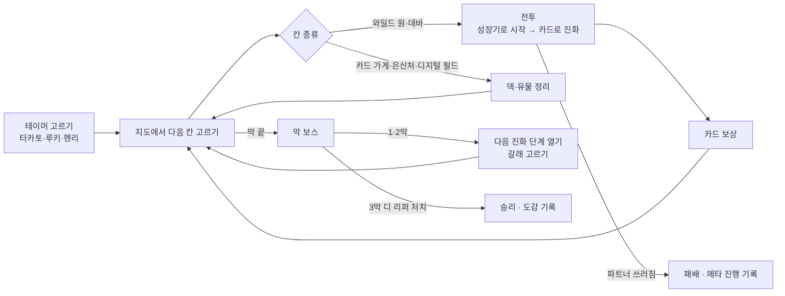
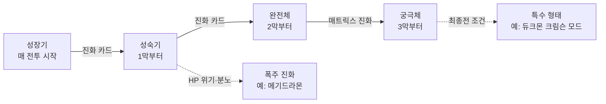

# 01. 기획 초안 (Game Design Draft)

> 상태: 초안 v0.3 (2026-11-13) — 열린 질문 대부분 결정. 남은 것은 마지막 "열린 질문"에 있습니다.
> 가제: **디지몬 덱 로그 (DIGIMON DECK ROGUE)**. 이름은 바꿀 수 있습니다.

## 0. 정한 것 (2026-11-13)

| 항목 | 결정 |
| :--- | :--- |
| 원작 | 디지몬 테이머즈 |
| 주인공 | **원작 테이머** (파트너와 짝) |
| 첫 플랫폼 | **모바일 먼저** (세로 화면, 한 손 조작) |
| 개발 방식 | **TypeScript 웹 앱 + Capacitor APK** (8절에 이유) |
| 한 판 길이 | **20~30분** (3막, 막마다 지도 7~8칸 + 보스) |
| 그림 | **새 도트** |
| 디지몬·인물 이름 | **한국 방영판 이름** (이름표 확인 필요, 11절) |
| 공개 범위 | **지인에게만** (GitHub 비공개 저장소 + 초대) |

## 1. 한 줄 컨셉

**테이머즈의 테이머가 되어 카드를 긁어(카드 슬래시) 파트너 디지몬을 싸움 중에 진화시키며, 현실 세계와 디지털 월드를 3막에 걸쳐 지나가는 모바일 덱빌딩 로그라이크.**

- 기본 틀은 슬더슬류와 같습니다: 분기 지도, 턴제 카드 전투, 전투 후 카드 보상, 유물, 판마다 처음부터.
- 테이머즈를 고른 이유: 원작에서 **카드가 곧 싸우는 방법**입니다. 테이머가 디지몬 카드를 디아크(D-Arc)에 긁으면 파트너가 그 힘을 얻습니다. "덱 = 테이머의 카드 컬렉션"이 이야기와 그대로 맞습니다.
- 차별점:
  1. **싸움 중 진화**: 원작처럼 파트너는 매 전투를 성장기로 시작하고, 진화 카드를 긁어 그 전투 안에서 올라갑니다.
  2. **매트릭스 진화**: 3막에서 테이머와 파트너가 하나가 되는 최종 형태. 전투 규칙 자체가 바뀝니다.
  3. **테이머마다 다른 특성**: 같은 카드라도 누구로 하느냐에 따라 쓰는 법이 달라집니다.

| 게임 | 성장 단위 | 이 게임과 다른 점 |
| :--- | :--- | :--- |
| Slay the Spire | 캐릭터 고정, 덱만 성장 | 이 게임은 전투마다 파트너가 진화해 올라감 |
| Decktamer | 몬스터를 잡아 파티·덱에 추가 | 이 게임은 한 마리를 깊게 키움 (수집보다 육성) |
| 디지몬 카드 게임 (TCG) | 대전, 덱은 미리 짬, 진화로 레벨업 | 진화 감각은 같지만 판 중에 덱을 만들고 적은 PvE |

## 2. 무대, 주인공, 막 구성

### 2-1. 주인공 = 원작 테이머
| 테이머 (한국판 이름 확인 필요) | 파트너 | 테이머 특성 (예시) | 플레이 성격 |
| :--- | :--- | :--- | :--- |
| 타카토 (오유민?) | 길몬 | **직접 그린 카드**: 판 시작에 슬래시 카드 1장을 골라 강화된 "내가 그린 카드"로 만듦 | 강한 한 방, 폭주 진화 위험 |
| 루키 (은세나?) | 레나몬 | **카드 배틀 실력자**: 매 턴 처음 긁는 슬래시 카드 메모리 -1 | 카드 여러 장 이어 내기 (콤보) |
| 헨리 (곽소룡?) | 테리어몬 | **침착함**: 매 턴 시작에 실드 +3 | 실드·여러 번 때리기 |
| 아이·마코 (해금) | 임프몬 | 정해야 함 | 성숙기·완전체 없이 바로 궁극체, 진화 비용 큼 |

- 다른 원작 인물(주리, 카즈, 켄타, 큐레몬, 히프노스 사람들)은 **이벤트와 "동료 카드"**로 나옵니다.

### 2-2. 이야기
- 원작 사건을 **무대로 쓰되, 장면은 짧게 새로 씁니다.** 원작 대사·장면을 그대로 옮기지 않습니다.
- 보여 주는 방식은 슬더슬처럼 가볍게:
  - 막 시작: 2~3줄 글 + 도트 그림 한 장
  - 지도의 "디지털 필드" 이벤트: 원작 인물과 짧은 선택지
  - 테이머마다 다른 엔딩 한 장면

### 2-3. 막 구성 (한 판 20~30분)
| 막 | 무대 | 적 | 파트너 최고 단계 | 보스 예시 |
| :---: | :--- | :--- | :--- | :--- |
| 1막 | 현실 세계 — 도시에 나타난 **와일드 원** | 와일드 원, 히프노스 감시 | 성숙기 | 데바 1체 |
| 2막 | 디지털 월드 | 데바, 디지털 월드 주민 | 완전체 | 데바 대장 |
| 3막 | 다시 현실 — **디 리퍼** 침공 | 디 리퍼 에이전트 | 궁극체 (매트릭스 진화) | 디 리퍼 |

- 막마다 지도 **7~8칸 + 보스**. 전투 하나는 **3~5턴**을 목표로 적 HP를 맞춥니다.
- 지도 칸 종류:

| 칸 | 테이머즈식 이름 | 하는 일 |
| :--- | :--- | :--- |
| 전투 | 와일드 원 출현 | 일반 전투 |
| 강적 | 데바 | 강한 전투, 문장 보상 |
| 상점 | 카드 가게 | 카드 사기·지우기 |
| 휴식 | 은신처 | HP 회복 또는 카드 강화 |
| 이벤트 | 디지털 필드 | 원작 인물과 선택지 |
| 보물 | 블루 카드 상자 | 희귀 카드·문장 |
| 보스 | 막 보스 | 막 끝 |

## 3. 핵심 루프



## 4. 전투 규칙

### 4-1. 기본
- 내 쪽은 **파트너 디지몬 1마리**(HP). 적은 1~3마리.
- 매 턴 손패 5장을 뽑고, **메모리 3**으로 카드를 긁습니다(냅니다). 턴이 끝나면 손패는 버림 더미로.
- 적은 다음 턴 행동(**인텐트**: 공격 수치, 방어, 강화, 디버프)을 미리 보여 줍니다.
- 방어는 **실드**: 받는 피해를 먼저 막고 턴이 끝나면 사라집니다.
- 모바일 조작: 카드를 위로 끌어 올리면 긁기, 적 위에 놓으면 그 적을 대상으로. 카드를 누르고 있으면 크게 보기.

### 4-2. 싸움 중 진화 (핵심)
- 파트너는 **매 전투를 성장기로 시작**합니다.
- **진화 카드**를 긁으면 한 단계 위로 진화합니다 (메모리 2 / 3 / 4, 단계가 높을수록 비쌈).
  - 진화하면 최대 HP·실드가 오르고 **카드 1장을 뽑습니다** (디지몬 카드 게임의 "진화 시 1드로우").
  - 그 판에서 열어 둔 **최고 단계**까지만 진화할 수 있습니다.
- 카드에는 **단계 제한**이 있습니다. 완전체 기술은 파트너가 완전체일 때만 낼 수 있습니다.
  → "언제 진화하고, 진화 전엔 뭘 버틸까"가 매 전투의 퍼즐이 됩니다.
- 전투가 끝나면 파트너는 다시 성장기로 돌아갑니다 (원작처럼).

### 4-3. 메모리 당겨쓰기 (TCG 메모리 게이지에서 따옴)
- 메모리가 모자라도 **최대 3까지 더 쓸 수 있습니다.** 넘어간 만큼 **적이 다음 턴에 "가속"**(공격 +25%/점 또는 추가 행동)을 얻습니다.
- 급하게 진화하려고 당겨쓸지, 한 턴 버틸지를 고르게 합니다. 수치는 봇 측정으로 정합니다.

### 4-4. 속성 상성
- 백신 → 바이러스 → 데이터 → 백신 (화살표 방향으로 유리). 유리하면 피해 ×1.5, 불리하면 ×0.75.
- 진화 갈래에 따라 파트너 속성이 바뀔 수 있습니다. 적 속성은 인텐트 옆에 표시합니다.

### 4-5. 카드 종류
| 종류 | 역할 | 예시 |
| :--- | :--- | :--- |
| 슬래시 카드 | 긁으면 파트너가 바로 힘을 씀. 공격·방어·강화 | 공격 플러그인 (피해 +), 하이퍼 윙 (회피) |
| 기술 카드 | 파트너 형태의 필살기. 단계 제한 있음 | 길몬 "파이어 볼", 그라우몬 "엑조스트 플레임" |
| 진화 카드 | 싸움 중 한 단계 진화 | 성숙기 진화, 완전체 진화 |
| 동료 카드 | 다른 원작 인물의 도움. 전투 동안 계속 효과 (자리 최대 2) | 주리: 매 턴 HP 2 회복 |
| 블루 카드 | 희귀. 진화 비용 0 또는 특수 진화 | 블루 카드: 이번 턴 진화 비용 0 |
| 저주·상태 | 나쁜 카드 (폭주 진화 등으로 들어옴) | 버그 데이터 |

## 5. 진화 시스템



- **최고 단계 열기 (판 진행)**: 막 보스를 이기면 다음 단계가 열립니다. 이때 진화 갈래가 있으면 고르고, 새 형태의 기술 카드 1장을 받습니다.
- **파트너 계열** (이름은 한국 방영판으로 확인 필요):

| 파트너 | 성숙기 | 완전체 | 궁극체 |
| :--- | :--- | :--- | :--- |
| 길몬 | 그라우몬 | 메가로그라우몬 | 듀크몬 |
| 레나몬 | 쿄우비몬 | 타오몬 | 사쿠야몬 |
| 테리어몬 | 갈고몬 | 래피드몬 | 세인트갈고몬 |
| 임프몬 (해금) | — | — | 베르제브몬 |

- **매트릭스 진화 (궁극체)**: 테이머와 파트너가 하나가 됩니다. 그 전투 동안 동료 카드 자리가 닫히는 대신 **손패 +2, 매 턴 메모리 +1**.
- **폭주 진화**: HP가 25% 아래일 때 고를 수 있습니다. 길몬은 메기드라몬이 됩니다. 매우 강하지만 매 턴 자기 HP가 줄고, 전투 뒤 덱에 저주 카드가 들어옵니다.
- **큐레몬**: 이벤트로 만나면 몇 전투 동안 함께 다니며 진화 비용을 1 줄여 줍니다.
- **특수 형태 (선택 규칙)**: 최종전에서 조건을 채우면 듀크몬 크림슨 모드처럼 한 단계 더 올라갑니다.

## 6. 보상과 성장 (한 판 안)

| 출처 | 보상 |
| :--- | :--- |
| 전투 (와일드 원) | 카드 3장 중 1장 또는 건너뛰기, 비트(돈) |
| 강적 (데바) | 위 + **문장** 1개 |
| 보스 | 위 + 희귀 카드 + 다음 진화 단계 열기 |
| 카드 가게 | 카드·동료 카드·문장 구매, 카드 1장 지우기 |
| 은신처 | HP 30% 회복 **또는** 카드 1장 강화 |
| 디지털 필드 (이벤트) | 원작 인물과 선택지 (카드 얻기·잃기, HP 거래, 큐레몬) |
| 블루 카드 상자 | 블루 카드 또는 문장 |

- **문장 (유물)**: 판 내내 계속 효과. 예: "진화할 때 실드 +5", "매 전투 첫 턴 카드 1장 더 뽑기". 이름은 테이머즈에 맞게 바꿀 수 있습니다 (예: 디아크 업그레이드).
- **디아크 (시작 유물)**: 판 시작에 1개 고름. 예: "진화 카드 메모리 -1 (한 전투 1번)", "시작 손패 +1".

## 7. 메타 진행 (판 밖)

- **도감**: 진화시킨 형태, 만난 와일드 원·데바가 기록됩니다.
- **테이머 해금**: 처음엔 타카토·루키·헨리. 업적으로 아이·마코(임프몬) 등 해금.
- **디아크 해금**: 보스 처치·특정 진화로 새 시작 유물.
- **난이도 단계 "디지털 해저드" 1~10**: 이기면 다음 단계가 열림. 단계마다 규칙 하나씩 어려워짐.
- 메타 진행은 **선택지를 늘리는 쪽**으로만 두고, 영구 능력치 상승은 넣지 않습니다.
- 저장은 휴대폰 안(IndexedDB)에만. 판 도중에 앱을 닫아도 이어 하기.

## 8. 기술 스택

### 8-1. 추천: TypeScript 웹 앱 + Capacitor APK
```
DigimonDeckRogue/
├─ src/core/     게임 규칙 (TypeScript, 화면 무관) — 전투, 덱, 지도 생성, 진화, 저장 형식
├─ src/ui/       모바일 화면 (Vite + TypeScript, 세로) — 손패 끌기, 지도, 연출
├─ data/         디지몬·카드·적·이벤트 JSON
├─ tools/sim/    자동 플레이 봇 · 밸런스 측정 (Node, 서브컴퓨터에서 돌리기 좋음)
├─ tests/        규칙 단위 테스트 (Vitest) · 시드 고정 한 판 시뮬레이션
└─ android/      Capacitor APK (GitHub Actions가 빌드)
```

- **왜 이 방식인가**:
  - **가볍습니다.** 카드 게임은 화면이 거의 글·카드·버튼이라 웹 화면(DOM)이 잘 맞습니다. C# 엔진을 WebAssembly로 싣는 방식(DigimonTcg 모바일)은 엔진만 압축해서 약 2.7MB를 받아야 하는데, TypeScript는 그게 없어 처음 열기가 빠릅니다.
  - **한 언어로 끝납니다.** 규칙·화면·봇·테스트가 모두 TypeScript입니다. smart-ledger·pokeclear에서 이미 쓰는 도구(Vite, TypeScript)입니다.
  - **지인 공유가 쉽습니다.** 같은 빌드로 링크(웹)와 APK를 둘 다 만듭니다.
  - **C# 재사용 손해가 작습니다.** 테이머즈 디지몬 데이터는 어차피 새로 만들어야 해서, Survivors C# 코드에서 가져올 것이 적습니다.
- **다른 방식과 비교**:

| 방식 | 좋은 점 | 아쉬운 점 |
| :--- | :--- | :--- |
| **TypeScript + Capacitor (추천)** | 가벼움, 한 언어, 웹·APK 같이 | C# 코드 재사용 없음 |
| C# Core + WebAssembly + 웹 화면 | DigimonTcg 방식 그대로, C# 테스트 | 엔진 다운로드가 무겁고, 화면은 어차피 JS로 따로 씀 |
| Godot 4 .NET 안드로이드 | 연출 만들기 쉬움 | C# 안드로이드 내보내기 시험 필요, 웹판 어려움 |

- 새로 쓰는 라이브러리(Vite, Vitest, Capacitor)는 모두 MIT 라이선스입니다.

### 8-2. 기존 프로젝트에서 가져올 것
| 가져올 것 | 출처 | 쓰는 곳 |
| :--- | :--- | :--- |
| 휴대폰 끌어 놓기·뒤로 버튼 처리·전체 화면 | DigimonTcg `src/DigimonTcg.Web/wwwroot/js`, `mobile-app` | 손패 조작, APK 동작 |
| Capacitor 설정, 서비스 워커(오프라인), APK 빌드 워크플로 | DigimonTcg `mobile-app`, `.github/workflows/android-apk.yml` | 오프라인 실행, APK 자동 빌드 |
| 디지몬 데이터 형식 (단계·속성·진화 후보) | Survivors `Core/Data/Json/digimons.json` | 데이터 형식 참고. **테이머즈 계열은 임프몬·베르제브몬만 있어 나머지는 새로 씀** |
| 문장·해금 조건 형식 | Survivors `Core/Data/Json/relics.json` | 유물·메타 진행 (효과는 새로 씀) |
| 효과음 합성 방식 (`SoundSynth`) | Survivors `Core/Audio` | WebAudio로 옮겨 씀 |
| 봇 측정 방식 (BalanceLab) | Survivors `tools/BalanceLab` | 카드·적 수치 맞추기 |
| 진화 시 드로우, 메모리 개념 | DigimonTcg `Core/Engine` | 규칙 참고 |

- 다른 저장소의 파일은 **복사해서** 가져옵니다 (저장소끼리 묶지 않음).
- **새로 만들어야 하는 것**: 테이머즈 디지몬 12형태 + 임프몬 계열, 데바·디 리퍼, 테이머 3명의 도트 그림과 데이터.

## 9. MVP 범위와 로드맵

| 단계 | 내용 | 끝났다는 기준 |
| :--- | :--- | :--- |
| 0. 규칙 프로토타입 | `src/core`만. 타카토·길몬 (성장기·성숙기), 카드 20장, 와일드 원 6종, 1막 지도 7칸, 데바 보스 1 | 봇이 1막을 1,000판 돌려 승률·턴 수가 나옴 |
| 1. 1막 모바일 웹 | 세로 화면: 지도, 전투, 카드 끌기·진화 연출, 보상. 휴대폰 브라우저에서 | 사람이 휴대폰으로 1막을 처음부터 끝까지 할 수 있음 |
| 2. 3막 + APK | 테이머 3명, 카드 약 70장, 적 20종, 보스 3, 문장 10, 이벤트 8, APK 빌드 | 한 판 20~30분, 봇 승률 목표 안, 지인이 APK로 설치 |
| 3. 깊이 | 매트릭스 진화, 폭주 진화, 큐레몬, 디지털 해저드 1~10, 도감, 임프몬 | 해금 흐름이 끝까지 이어짐 |
| 4. PC (선택) | 같은 웹 빌드를 가로 화면에 맞춤 | PC 브라우저에서 한 판 |

## 10. 저작권·배포 원칙

- **비공식·비영리 팬 게임**이고 **지인에게만** 공개합니다. 판매, 광고, 후원 보상은 넣지 않습니다.
- 디지몬과 디지몬 테이머즈 관련 명칭·캐릭터·이미지 저작권은 © BANDAI / TOEI ANIMATION / WiZ 등에 있습니다. README와 게임 안 정보 화면에 적습니다.
- 원작 인물은 쓰지만 원작 대사·장면을 그대로 옮기지 않습니다. 원작 화면 캡처·공식 그림은 쓰지 않고 도트로 새로 그립니다.
- 공식 카드 이미지·공식 카드 데이터(DigimonCard.io, 공식 사이트)는 **넣지 않습니다**.
- 공개 범위:
  - 코드: **GitHub 비공개 저장소**, 지인은 협업자로 초대.
  - 게임: **APK는 GitHub Release**(비공개라 로그인 필요, DigimonTcg와 같음). 웹 링크로도 나누려면 GitHub Pages는 비공개 저장소에서 무료로 안 되므로 **Cloudflare Pages + 허용한 이메일만 접속**(Cloudflare Access) 방식을 씁니다.
  - 오픈 라이선스는 두지 않습니다 (`package.json`에 `"license": "UNLICENSED"`).

## 11. 열린 질문

- [ ] 게임 이름 (가제 "디지몬 덱 로그"). 테이머즈 느낌의 이름으로 바꿀지
- [ ] 한국 방영판 이름표 만들기 — 테이머(오유민·은세나·곽소룡은 검색으로 찾은 후보)와 진화형 12개 이름 확인
- [ ] 웹 링크 공유를 할지, APK만 나눌지
- [ ] 아이·마코(임프몬) 테이머 특성
