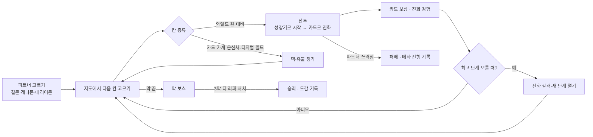
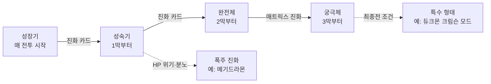

# 01. 기획 초안 (Game Design Draft)

> 상태: 초안 v0.2 (2026-11-13) — 컨셉을 **디지몬 테이머즈** 기반으로 정함. 정해지지 않은 것은 마지막 "열린 질문"에 모았습니다.
> 가제: **디지몬 덱 로그 (DIGIMON DECK ROGUE)**. 이름은 바꿀 수 있습니다.

## 1. 한 줄 컨셉

**새 테이머가 되어 카드를 긁어(카드 슬래시) 파트너 디지몬을 싸움 중에 진화시키며, 현실 세계와 디지털 월드를 3막에 걸쳐 지나가는 덱빌딩 로그라이크.**

- 기본 틀은 슬더슬류와 같습니다: 분기 지도, 턴제 카드 전투, 전투 후 카드 보상, 유물, 판마다 처음부터.
- 테이머즈를 고른 이유: 원작에서 **카드가 곧 싸우는 방법**입니다. 테이머가 디지몬 카드를 디아크(D-Arc)에 긁으면 파트너가 그 힘을 얻습니다. "덱 = 테이머의 카드 컬렉션"이 이야기와 그대로 맞습니다.
- 차별점 두 가지:
  1. **싸움 중 진화**: 원작처럼 파트너는 매 전투를 성장기로 시작하고, 진화 카드를 긁어 그 전투 안에서 성숙기·완전체로 올라갑니다. 판이 진행되면 "올라갈 수 있는 최고 단계"가 늘어납니다.
  2. **매트릭스 진화**: 3막에서 테이머와 파트너가 하나가 되는 최종 형태. 전투 규칙 자체가 바뀝니다.

| 게임 | 성장 단위 | 이 게임과 다른 점 |
| :--- | :--- | :--- |
| Slay the Spire | 캐릭터 고정, 덱만 성장 | 이 게임은 전투마다 파트너가 진화해 올라감 |
| Decktamer | 몬스터를 잡아 파티·덱에 추가 | 이 게임은 한 마리를 깊게 키움 (수집보다 육성) |
| 디지몬 카드 게임 (TCG) | 대전, 덱은 미리 짬, 진화로 레벨업 | 진화 감각은 같지만 판 중에 덱을 만들고 적은 PvE |

## 2. 무대와 막 구성

- 주인공은 원작 인물이 아닌 **새 테이머**입니다. 원작 인물(타카토·루키·헨리 등)은 이벤트·조연으로만 나옵니다. 원작 줄거리를 다시 만드는 게 아니라, 같은 세계에서 생긴 새 이야기로 둡니다.
- **1판 길이 목표: 40~60분.** 막마다 지도 약 15칸 + 보스.

| 막 | 무대 | 적 | 파트너 최고 단계 | 보스 예시 |
| :---: | :--- | :--- | :--- | :--- |
| 1막 | 현실 세계 — 도시에 나타난 **와일드 원** (현실로 넘어온 야생 디지몬) | 와일드 원, 히프노스 감시 | 성숙기 | 데바 1체 |
| 2막 | 디지털 월드 — 층마다 다른 지역 | 데바, 디지털 월드 주민 | 완전체 | 데바 대장 |
| 3막 | 다시 현실 — **디 리퍼(D-Reaper)** 침공 | 디 리퍼 에이전트 | 궁극체 (매트릭스 진화) | 디 리퍼 |

- 지도 칸 종류:

| 칸 | 테이머즈식 이름 | 하는 일 |
| :--- | :--- | :--- |
| 전투 | 와일드 원 출현 | 일반 전투 |
| 강적 | 데바 | 강한 전투, 문장 보상 |
| 상점 | 카드 가게 | 카드 사기·지우기 |
| 휴식 | 은신처 | HP 회복 또는 카드 강화 |
| 이벤트 | 디지털 필드 | 글 선택지 (원작 인물 등장 포함) |
| 보물 | 블루 카드 상자 | 희귀 카드·문장 |
| 보스 | 막 보스 | 막 끝 |

## 3. 핵심 루프



## 4. 전투 규칙

### 4-1. 기본
- 내 쪽은 **파트너 디지몬 1마리**(HP). 적은 1~3마리.
- 매 턴 손패 5장을 뽑고, **메모리 3**으로 카드를 긁습니다(냅니다). 턴이 끝나면 손패는 버림 더미로.
- 적은 다음 턴 행동(**인텐트**: 공격 수치, 방어, 강화, 디버프)을 미리 보여 줍니다.
- 방어는 **실드**: 받는 피해를 먼저 막고 턴이 끝나면 사라집니다.

### 4-2. 싸움 중 진화 (핵심)
- 파트너는 **매 전투를 성장기로 시작**합니다.
- **진화 카드**를 긁으면 한 단계 위로 진화합니다 (메모리 2 / 3 / 4, 단계가 높을수록 비쌈).
  - 진화하면 최대 HP·실드가 오르고 **카드 1장을 뽑습니다** (디지몬 카드 게임의 "진화 시 1드로우").
  - 그 판에서 열어 둔 **최고 단계**까지만 진화할 수 있습니다.
- 카드에는 **단계 제한**이 있습니다. 완전체 기술은 파트너가 완전체일 때만 낼 수 있습니다.
  → "언제 진화하고, 진화 전엔 뭘 버틸까"가 매 전투의 퍼즐이 됩니다.
- 전투가 끝나면 파트너는 다시 성장기로 돌아갑니다 (원작처럼).

### 4-3. 메모리 당겨쓰기 (TCG 메모리 게이지에서 따옴)
- 메모리가 모자라도 **최대 3까지 더 쓸 수 있습니다.** 넘어간 만큼 **적이 다음 턴에 "가속"**(공격 +25%/점 또는 추가 행동)을 얻습니다.
- 급하게 진화하려고 당겨쓸지, 한 턴 버틸지를 고르게 합니다. 수치는 봇 측정으로 정합니다.

### 4-4. 속성 상성
- 백신 → 바이러스 → 데이터 → 백신 (화살표 방향으로 유리). 유리하면 피해 ×1.5, 불리하면 ×0.75.
- 진화 갈래에 따라 파트너 속성이 바뀔 수 있습니다. 적 속성은 인텐트 옆에 표시합니다.

### 4-5. 카드 종류
| 종류 | 역할 | 예시 |
| :--- | :--- | :--- |
| 슬래시 카드 | 긁으면 파트너가 바로 힘을 씀. 공격·방어·강화 | 공격 플러그인 (피해 +), 하이퍼 윙 (회피) |
| 기술 카드 | 파트너 형태의 필살기. 단계 제한 있음 | 길몬 "파이어 볼", 그라우몬 "엑조스트 플레임" |
| 진화 카드 | 싸움 중 한 단계 진화 | 성숙기 진화, 완전체 진화 |
| 테이머 카드 | 전투 동안 계속 효과 (자리 최대 2) | 침착함: 매 턴 첫 슬래시 카드 메모리 -1 |
| 블루 카드 | 희귀. 진화 비용 0 또는 특수 진화 | 블루 카드: 이번 턴 진화 비용 0 |
| 저주·상태 | 나쁜 카드 (폭주 진화 등으로 들어옴) | 버그 데이터 |

## 5. 진화 시스템



- **최고 단계 열기 (판 진행)**: 막 보스를 이기면 다음 단계가 열립니다. 이때 진화 갈래가 있으면 고르고, 새 형태의 기술 카드 1장을 받습니다.
- **스타터 계열 (원작 기준)**:

| 파트너 | 성숙기 | 완전체 | 궁극체 | 플레이 성격 |
| :--- | :--- | :--- | :--- | :--- |
| 길몬 | 그라우몬 | 메가로그라우몬 | 듀크몬 | 강한 한 방, 폭주 진화 위험 |
| 레나몬 | 쿄우비몬 | 타오몬 | 사쿠야몬 | 카드 여러 장 이어 내기 (콤보) |
| 테리어몬 | 갈고몬 | 래피드몬 | 세인트갈고몬 | 실드·여러 번 때리기 |
| 임프몬 (해금) | — | — | 베르제브몬 | 성숙기·완전체 없이 바로 궁극체, 진화 비용 큼 |

- **매트릭스 진화 (궁극체)**: 테이머와 파트너가 하나가 됩니다. 그 전투 동안 테이머 카드 자리가 닫히는 대신 **손패 +2, 매 턴 메모리 +1**.
- **폭주 진화**: HP가 25% 아래일 때 고를 수 있습니다. 길몬은 메기드라몬이 됩니다. 매우 강하지만 매 턴 자기 HP가 줄고, 전투 뒤 덱에 저주 카드가 들어옵니다.
- **큐레몬**: 이벤트로 만나면 몇 전투 동안 함께 다니며 진화 비용을 1 줄여 줍니다.
- **특수 형태 (선택 규칙)**: 최종전에서 조건을 채우면 듀크몬 크림슨 모드처럼 한 단계 더 올라갑니다.

## 6. 보상과 성장 (한 판 안)

| 출처 | 보상 |
| :--- | :--- |
| 전투 (와일드 원) | 카드 3장 중 1장 또는 건너뛰기, 비트(돈) |
| 강적 (데바) | 위 + **문장** 1개 |
| 보스 | 위 + 희귀 카드 + 다음 진화 단계 열기 |
| 카드 가게 | 카드·테이머 카드·문장 구매, 카드 1장 지우기 |
| 은신처 | HP 30% 회복 **또는** 카드 1장 강화 |
| 디지털 필드 (이벤트) | 글 선택지 (카드 얻기·잃기, HP 거래, 큐레몬, 원작 인물) |
| 블루 카드 상자 | 블루 카드 또는 문장 |

- **문장 (유물)**: 판 내내 계속 효과. 예: "진화할 때 실드 +5", "매 전투 첫 턴 카드 1장 더 뽑기". 이름은 테이머즈에 맞게 바꿀 수 있습니다 (예: 디아크 업그레이드).
- **디아크 (시작 유물)**: 판 시작에 1개 고름. 예: "진화 카드 메모리 -1 (한 전투 1번)", "시작 손패 +1".

## 7. 메타 진행 (판 밖)

- **도감**: 진화시킨 형태, 만난 와일드 원·데바가 기록됩니다.
- **파트너 해금**: 처음엔 길몬·레나몬·테리어몬 3종. 업적으로 임프몬, 가드로몬, 로프몬 등 해금.
- **디아크 해금**: 보스 처치·특정 진화로 새 시작 유물.
- **난이도 단계 "디지털 해저드" 1~10**: 이기면 다음 단계가 열림. 단계마다 규칙 하나씩 어려워짐.
- 메타 진행은 **선택지를 늘리는 쪽**으로만 두고, 영구 능력치 상승은 넣지 않습니다.

## 8. 기술 스택과 재사용

DigimonSurvivors와 같은 구조를 추천합니다. 이미 익숙하고, 테스트·측정 방식을 그대로 가져올 수 있습니다.

```
DigimonDeckRogue.sln
├─ src/DigimonDeckRogue.Core/    게임 규칙 (엔진 무관, net8.0) — 전투, 덱, 지도 생성, 진화, 저장
├─ src/DigimonDeckRogue.Godot/   Godot 4 .NET 화면 — 손패, 카드 슬래시 연출, 지도
├─ tools/DigimonDeckRogue.Sim/   자동 플레이 봇 · 밸런스 측정 (서브컴퓨터에서 돌리기 좋음)
└─ tests/DigimonDeckRogue.Tests/ 데이터 무결성 · 전투 규칙 · 시드 고정 한 판 시뮬레이션
```

| 가져올 것 | 출처 | 쓰는 곳 |
| :--- | :--- | :--- |
| 디지몬 데이터 형식 (단계·속성·색·진화 후보·조그레스 재료) | Survivors `Core/Data/Json/digimons.json` | 데이터 형식만. **테이머즈 계열은 임프몬·베르제브몬만 있어 나머지는 새로 씀** |
| 문장·해금 조건 형식 | Survivors `Core/Data/Json/relics.json` | 유물·메타 진행 (효과는 새로 씀) |
| 적으로 쓸 디지몬 스프라이트 일부 | Survivors `assets/Sprites` (120장) | 와일드 원 (공개 전 출처 확인 필요) |
| 효과음·BGM 합성 (`SoundSynth`) | Survivors `Core/Audio` | 소리 |
| 설정 저장, 판 결과 리포트 패턴 | Survivors `Persistence`, `Presentation/RunReport` | 저장·결과 화면 |
| BalanceLab 봇 측정 방식 | Survivors `tools/BalanceLab` | 카드·적 수치 맞추기 |
| 진화 시 드로우, 메모리 개념 | DigimonTcg `Core/Engine` | 규칙 참고 (코드 재사용은 적음) |
| Core → WebAssembly로 휴대폰에서 돌리기 | DigimonTcg `Web.Engine`, `mobile-app` | 나중에 모바일·APK판 |

- 다른 저장소의 파일은 **복사해서** 가져옵니다 (저장소끼리 묶지 않음).
- **새로 만들어야 하는 것**: 길몬·레나몬·테리어몬 계열 12형태와 데바·디 리퍼의 데이터와 그림.

## 9. MVP 범위와 로드맵

| 단계 | 내용 | 끝났다는 기준 |
| :--- | :--- | :--- |
| 0. 규칙 프로토타입 | Core만. 길몬 1종 (성장기·성숙기), 카드 20장, 와일드 원 6종, 1막 지도, 데바 보스 1 | 봇이 1막을 1,000판 돌려 승률·턴 수가 나옴 |
| 1. 1막 플레이어블 | Godot 화면: 지도, 전투, 카드 슬래시·진화 연출, 보상 | 사람이 1막을 처음부터 끝까지 할 수 있음 |
| 2. 3막 확장 | 파트너 3종, 카드 약 90장, 적 25종, 보스 3, 문장 12, 이벤트 10 | 한 판 40~60분, 봇 승률 목표 안 |
| 3. 깊이 | 매트릭스 진화, 폭주 진화, 큐레몬, 디지털 해저드 1~10, 도감 | 해금 흐름이 끝까지 이어짐 |
| 4. 모바일 | Core WebAssembly, 세로 화면, APK | 휴대폰에서 오프라인 한 판 |

## 10. 저작권·배포 원칙

- **비공식·비영리 팬 게임**입니다. 판매, 광고, 후원 보상은 넣지 않습니다.
- 디지몬과 디지몬 테이머즈 관련 명칭·캐릭터·이미지 저작권은 © BANDAI / TOEI ANIMATION / WiZ 등에 있습니다. README와 게임 안 정보 화면에 적습니다.
- 원작 줄거리·장면·대사를 그대로 옮기지 않습니다. 주인공과 이야기는 새로 씁니다.
- 공식 카드 이미지·공식 카드 데이터(DigimonCard.io, 공식 사이트)는 **넣지 않습니다**. 카드 그림은 자체 카드 틀로 만듭니다.
- 공개 저장소로 올리기 전에 `assets/`의 그림 출처를 확인합니다. 출처가 불분명한 그림은 저장소에서 빼고 따로 둡니다.
- 코드 라이선스는 올리기 전에 정합니다 (열린 질문 참고).

## 11. 열린 질문

- [ ] 게임 이름 (가제 "디지몬 덱 로그"). 테이머즈 느낌의 이름으로 바꿀지
- [ ] 첫 목표 플랫폼: PC(Godot) 먼저 / 모바일 먼저
- [ ] 주인공: 새 테이머 (현재 안) / 원작 테이머 중 고르기
- [ ] 파트너 이름 표기: 한국 방영판 이름 / 일본판 이름 (예: 듀크몬, 쿄우비몬 표기 확인)
- [ ] 1판 길이 40~60분이 맞는지 (짧게 20~30분 모드도 둘지)
- [ ] 그림 스타일: 새 도트 / 일러스트 / Survivors 스프라이트와 맞춤
- [ ] GitHub 저장소 공개/비공개, 코드 라이선스 (MIT 등)
