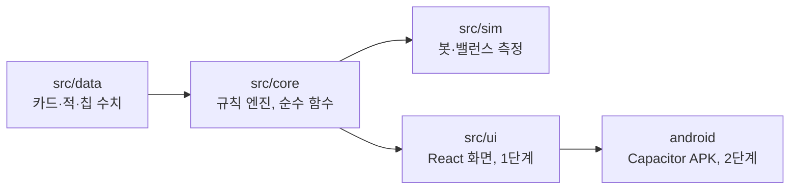

# 03. 구조 설계 (Architecture)

> 코드를 어디에 어떻게 쓰는지 정합니다. 규칙은 [02](02_RULES_SPEC.md), 작업 순서는 [04](04_ROADMAP.md)에 있습니다.

## 1. 한눈에



- **`core`는 화면을 모릅니다.** 상태와 행동을 받아 새 상태와 "무슨 일이 있었는지" 목록을 돌려주는 순수 함수입니다.
- 같은 `core`를 봇(`sim`)과 화면(`ui`)이 함께 씁니다. 그래서 봇으로 잰 밸런스가 실제 게임과 같습니다.
- 화살표 반대 방향으로는 import하지 않습니다 (`core`가 `ui`나 `sim`을 import하면 안 됨).

## 2. 기술과 버전

| 쓰는 것 | 용도 | 라이선스 |
| :--- | :--- | :--- |
| Node.js 22 이상 | 개발·봇 실행 | MIT |
| TypeScript (strict) | 모든 코드 | Apache-2.0 |
| Vite | 개발 서버·빌드 | MIT |
| Vitest | 테스트 | MIT |
| ESLint + typescript-eslint, Prettier | 규칙 검사·모양 맞춤 | MIT |
| tsx | 봇 명령 실행 | MIT |
| React 19, Zustand (1단계) | 화면, 화면 상태 | MIT |
| Tailwind CSS (1단계) | 스타일 | MIT |
| Capacitor (2단계) | APK | MIT |
| pixelfx (코드 복사, `src/ui/fx/pixelfx/`) | 전투 도트 효과 (04 7절) | MIT |

- 버전은 설치하는 날의 최신 안정판을 쓰고 `package-lock.json`으로 고정합니다.
- **위 표에 없는 라이브러리를 넣으려면 먼저 사용자에게 묻습니다.** `core`와 `data`에는 실행 시 필요한 외부 라이브러리를 넣지 않습니다.

## 3. 폴더 구조

```
DigimonDeckRogue/            (저장소: digimon-tamers-blue-card)
├─ CLAUDE.md                 작업 지침
├─ docs/                     기획·명세·설계·작업 목록, balance/ 측정 기록
├─ src/
│  ├─ core/                  규칙 엔진
│  │  ├─ index.ts            밖에서 쓰는 것만 내보냄 (5절)
│  │  ├─ types.ts            모든 타입 (4절)
│  │  ├─ rng.ts              시드 난수
│  │  ├─ state.ts            createInitialState
│  │  ├─ meta.ts             프로필·해금·도감 (02 13.5, 판 밖)
│  │  ├─ engine.ts           applyAction, getLegalActions (행동을 아래 모듈로 넘김)
│  │  ├─ battle/
│  │  │  ├─ start.ts         전투 시작 (02 3.2)
│  │  │  ├─ piles.ts         뽑기·임시 카드 넣기 (02 3.4). drawPile은 배열의 끝이 맨 위
│  │  │  ├─ outcome.ts       승패 (02 3.11)
│  │  │  ├─ turn.ts          턴 시작·턴 끝·뽑기 (02 3.3, 3.4, 3.10)
│  │  │  ├─ cards.ts         카드 내기 (02 3.5)
│  │  │  ├─ effects.ts       효과 op 실행 (02 4.3)
│  │  │  ├─ damage.ts        피해 계산·적용 (02 3.8)
│  │  │  ├─ evolve.ts        진화 (02 3.7)
│  │  │  ├─ rampage.ts       폭주 진화 (02 13.2)
│  │  │  └─ enemy.ts         적 행동·인텐트 (02 3.10)
│  │  ├─ run/
│  │  │  ├─ start.ts         startRun, 시작 칩·변이 고르기, 테이머 특성 (02 8, 12.7, 15.1)
│  │  │  ├─ map.ts           지도 생성·이동 (02 6)
│  │  │  ├─ reward.ts        보상·카드 고르기 (02 7.1)
│  │  │  ├─ shop.ts          상점 (02 7.2)
│  │  │  ├─ rest.ts          휴식 (02 7.3)
│  │  │  ├─ event.ts         이벤트·보물·런 효과 (02 7.4, 7.5)
│  │  │  └─ act.ts           막 넘어가기 (02 7.6)
│  │  ├─ chips.ts            칩 발동 (02 5)
│  │  ├─ mutation.ts         고른 변이의 효과 읽기 (02 15.1, 거는 곳은 각 모듈)
│  │  ├─ describe.ts         카드·칩·인텐트 설명 글 만들기
│  │  ├─ helpers.ts          여러 모듈이 함께 쓰는 작은 도우미 (단계 순서, 지금 형태, 카드 면)
│  │  └─ phase.ts            국면 바꾸기 (setPhase, returnToMap)
│  ├─ data/                  수치와 이름 (TypeScript 객체)
│  │  ├─ constants.ts        규칙 상수 (HAND_SIZE 등)
│  │  ├─ forms.ts  cards.ts(공용·오유민)  cards-rika.ts  cards-henry.ts  cards-ai-mako.ts  cards-ryo.ts  enemies.ts  encounters.ts
│  │  ├─ chips.ts  events.ts  tamers.ts  acts.ts(막 이름·시작 글)  mutations.ts(변이 카드, 02 15.1)
│  │  ├─ meta.ts             처음 열린 테이머·시작 칩, 해금 순서 (02 13.5, 두 번째 승리 15.2)
│  │  └─ index.ts            id로 찾는 함수 (getCard, getEnemy…)
│  ├─ sim/                   봇과 측정
│  │  ├─ policies/random.ts  policies/greedy.ts  policies/types.ts(정책 타입)
│  │  ├─ rng.ts              봇 전용 시드 난수 (7.1, state.rng와 따로)
│  │  ├─ runner.ts           한 판 돌리기, 여러 판 모으기
│  │  ├─ report.ts           지표 계산·목표와 비교
│  │  └─ cli.ts              npm run sim
│  └─ ui/                    (1단계) 화면 (9.1)
├─ tests/
│  ├─ core/                  규칙 테스트
│  ├─ data/                  데이터 무결성 테스트
│  ├─ sim/                   봇 스모크·결정성·골든 테스트
│  ├─ ui/                    화면 쪽 테스트 (저장, 재생 줄, 도트, 효과, 소리 등)
│  └─ helpers/               테스트용 전투 만들기 등
├─ scripts/
│  ├─ upper-drive.mjs        dev·build·test·e2e 실행기 (Windows 소문자 드라이브 경로에서 vitest·Tailwind가 깨지는 문제를 피함)
│  ├─ card-texts.ts          카드·칩 설명 글을 docs/balance/card-texts.md로 출력
│  ├─ e2e/                   npm run e2e (battle.mjs 시나리오, browser.mjs 브라우저 조작)
│  ├─ perf/bench.mjs         npm run perf (첫 화면·카드 끌기·턴 끝 연출의 메인 스레드 시간)
│  └─ art/battle-bg.mjs      막별 전투 배경 도트를 그려 src/ui/art/stage/에 저장
├─ public/                   아이콘, manifest.webmanifest (9.1)
├─ pwa/                      서비스 워커 템플릿 sw.js, 안드로이드 아이콘 앞면 그림(icon-foreground.svg)
├─ android/                  (2단계) Capacitor 안드로이드 프로젝트. 설정은 capacitor.config.json
└─ .github/workflows/
   ├─ ci.yml                 검사 (10절)
   ├─ pages.yml              GitHub Pages 배포 (9.1)
   └─ android-apk.yml        APK 빌드 (v* 태그 또는 손으로 실행)
```

## 4. 타입 (src/core/types.ts)

아래를 그대로 시작점으로 씁니다. 필드를 더해야 하면 더하되, 이 문서도 함께 고칩니다.

```ts
export type Stage = 'rookie' | 'champion' | 'ultimate' | 'mega';
export type Attribute = 'vaccine' | 'data' | 'virus' | 'none';
export type StatusId = 'strength' | 'weak' | 'vulnerable';
export type TamerId = 'takato' | 'rika' | 'henry' | 'ai_mako' | 'ryo';
export type CardType = 'attack' | 'skill' | 'signature' | 'curse' | 'companion';
export type FormTraitId = 'tough' | 'sharp';   // 형태 특성 (02 12.5)
export type Rarity = 'basic' | 'common' | 'uncommon' | 'rare' | 'special';
export type Keyword = 'exhaust' | 'retain' | 'innate' | 'unplayable';

// ── 효과 (02 4.3) ──
export type Effect =
  | { op: 'damage'; amount: number; hits?: number; target: 'enemy' | 'allEnemies' | 'randomEnemy' }
  | { op: 'shield'; amount: number }
  | { op: 'draw'; count: number }
  | { op: 'gainMemory'; amount: number }
  | { op: 'heal'; amount: number }
  | { op: 'loseHp'; amount: number }
  | { op: 'applyStatus'; status: StatusId; amount: number; target: 'enemy' | 'allEnemies' | 'self' }
  | { op: 'freeEvolve' }
  | { op: 'addCard'; cardId: string; to: 'hand' | 'discard' | 'draw'; count: number }
  | { op: 'ifStage'; min: Stage; then: Effect[]; else?: Effect[] }
  | { op: 'ifEvolvedThisTurn'; then: Effect[]; else?: Effect[] }
  | { op: 'ifPlayedThisTurn'; min: number; then: Effect[]; else?: Effect[] };   // 이 카드보다 먼저 이번 턴에 낸 카드가 min장 이상 (02 12.11)

// ── 정의 (src/data가 채움, 바뀌지 않음) ──
export interface CompanionEffect {   // 동료 효과 (02 12.6): 칩과 같은 구조
  trigger?: ChipTrigger; effects?: Effect[]; modifiers?: { evolveCostDelta?: number };
}
export interface CardFace {
  cost: number; effects: Effect[]; keywords?: Keyword[];
  companion?: CompanionEffect;   // 동료 카드만: 동료 자리에 있는 동안의 효과
}
export interface CardDef {
  id: string; name: string; type: CardType; rarity: Rarity;
  pool: TamerId | 'neutral' | 'none';   // 'none': 보상·상점에 안 나옴
  base: CardFace; upgraded: CardFace;
}
export interface FormDef {
  id: string; name: string; line: string;   // line: 계열 id (예: 'guilmon')
  stage: Stage; attribute: Attribute;
  tempHp: number; power: number; signatureCardId?: string;
  rampage?: boolean;   // 폭주 형태 (02 13.2): 보통 진화로는 되지 않음
}
export type EnemyEffect =
  | { op: 'attack'; amount: number; hits?: number }
  | { op: 'shield'; amount: number }
  | { op: 'applyStatus'; status: StatusId; amount: number; target: 'self' | 'player' }
  | { op: 'addCard'; cardId: string; to: 'discard' | 'draw'; count: number };
export interface EnemyMove { id: string; name: string; effects: EnemyEffect[] }
export interface EnemyPhase { untilHpPct?: number; onEnter?: string; cycle: string[] }
export interface EnemyDef {
  id: string; name: string; tier: 'normal' | 'elite' | 'boss';
  attribute: Attribute; maxHp: number;
  moves: EnemyMove[]; phases: EnemyPhase[];
  reactions?: EnemyReaction[];   // 02 14.1
}
export type EnemyCondition =   // 02 14.1
  | { partnerStageAtLeast: Stage } | { alone: true } | { playerHpAtMostPct: number };
export interface EnemyReaction { when: EnemyCondition; move: string }
export interface EncounterDef { id: string; act: number; tier: 'easy' | 'normal' | 'elite' | 'boss'; enemies: string[] }
export type ChipTrigger = 'onBattleStart' | 'onFirstTurn' | 'onTurnStart' | 'onEvolve' | 'onCardPlayed';
export interface ChipDef {
  id: string; name: string;
  trigger?: ChipTrigger; effects?: Effect[];
  hidden?: boolean;   // 테이머 특성용 숨은 칩: 보상·상점에 안 나오고 칩으로 보이지 않음 (02 12.3)
  start?: boolean;    // 시작 칩: 판 시작에만 고름 (02 12.7)
  modifiers?: {
    evolveCostDelta?: number;
    firstCardCostDelta?: number;   // 그 턴에 처음 내는 카드의 비용에 더함 (02 12.11)
    handGroups?: number;           // 2면 턴 시작에 두 묶음을 뽑아 하나를 고름 (02 13.3)
    battleBitsBonus?: number; handSizeBonus?: number; maxHpBonus?: number;
  };
}
export type RunEffect =
  | { op: 'heal'; amount: number } | { op: 'loseHp'; amount: number } | { op: 'gainBits'; amount: number }
  | { op: 'addRandomCard'; rarity: Rarity }
  | { op: 'offerCards'; count: number; upgraded?: boolean; rarity?: Rarity }
  | { op: 'addRandomChip' } | { op: 'addCard'; cardId: string }
  | { op: 'changeMaxHp'; amount: number } | { op: 'removeCard' } | { op: 'upgradeCard' };   // 02 14.2
export interface EventDef {
  id: string; acts: number[];   // acts: 나오는 막 (02 12.1)
  title: string; text: string; choices: { label: string; effects: RunEffect[] }[];
}
export type MutationEffect =   // 변이 효과 (02 15.1, 이 목록이 전부)
  | { op: 'enemyHpPct'; pct: number } | { op: 'enemyDamagePct'; pct: number }
  | { op: 'maxHp'; amount: number } | { op: 'startBits'; amount: number }
  | { op: 'shopPricePct'; pct: number } | { op: 'rewardCards'; amount: number }
  | { op: 'modifiers'; modifiers: MutationModifiers };
export type MutationModifiers =   // 칩의 수치 보정 중 세 가지만
  Pick<NonNullable<ChipDef['modifiers']>, 'evolveCostDelta' | 'handSizeBonus' | 'battleBitsBonus'>;
export interface MutationDef { id: string; name: string; good: MutationEffect[]; bad: MutationEffect[] }
export interface TamerDef {
  id: TamerId; name: string; trait: string; line: string; maxHp: number;   // trait: 테이머 특성 이름 (02 8, 12.3)
  startBits: number; startMaxStage: Stage; startMaxMemory: number;
  startDeck: string[]; startEffects: RunEffect[]; startChips: string[];
}

// ── 상태 (전부 JSON으로 저장할 수 있어야 함) ──
export interface CardInstance { uid: number; defId: string; upgraded: boolean; temp?: boolean }
export type Statuses = Record<StatusId, number>;
export interface EnemyState {
  defId: string; hp: number; maxHp: number; shield: number; alive: boolean;
  statuses: Statuses; accel: number;
  phaseIndex: number;
  cycleIndex: number;              // -1: onEnter 행동을 보여 주는 중 (02 3.10.1)
  intentMoveId: string;
  usedReactions: number[];         // 이 전투에서 쓴 반응의 번호 (02 14.1)
  reacting: boolean;               // 지금 인텐트가 반응인지 (표시용)
}
export interface BattleState {
  kind: 'normal' | 'elite' | 'boss';
  encounterId: string;
  hpAtStart: number;               // 전투 시작 때의 run.hp (지표용)
  evolveCount: number;             // 이번 전투에서 진화한 횟수 (지표용)
  turn: number; memory: number;
  stage: Stage; shield: number; tempHp: number; statuses: Statuses;
  evolvedThisTurn: boolean; freeEvolve: boolean;
  rampage: boolean;                      // 폭주 진화 중 (02 13.2)
  handChoice: CardInstance[][] | null;   // 두 사람의 카드: 고를 두 묶음 (고르기 전까지, 02 13.3)
  cardsPlayedThisTurn: number;           // 이번 턴에 낸 카드 수. 카드를 옮긴 뒤 올림 (02 12.3)
  drawPile: CardInstance[]; hand: CardInstance[]; discardPile: CardInstance[]; exhaustPile: CardInstance[];
  companions: CardInstance[];            // 동료 자리 (02 12.6)
  enemies: EnemyState[];
}
export type NodeType = 'battle' | 'elite' | 'event' | 'shop' | 'rest' | 'treasure' | 'boss';
export interface MapNode {
  id: string; row: number; col: number; type: NodeType;
  next: string[];                 // 이어진 다음 칸 id
  encounterId?: string;           // battle·elite·boss 칸
  eventId?: string;               // event 칸
}                                 // 보스 칸은 row 8, col 1 (02 6절)
export interface ActMap { nodes: MapNode[]; bossNodeId: string }
export interface RunState {
  tamerId: TamerId; act: number;
  hp: number; maxHp: number; bits: number;
  maxStage: Stage; maxMemory: number;
  deck: CardInstance[]; chips: string[];
  map: ActMap; nodeId: string | null;   // 지금 있는 칸 (막 시작 전에는 null)
  path: string[];                       // 이번 막에서 지나온 칸 id (지금 칸 포함)
  pastNodes: number;                    // 지난 막들에서 지나온 칸 수 (결과 화면 통계)
  removalsBought: number;
  hazard: number;                                    // 디지털 해저드 단계 (02 13.6)
  formTraits: Partial<Record<Stage, FormTraitId>>;   // 단계별로 고른 형태 특성 (02 12.5)
  mutation: string | null;                           // 고른 변이 id (02 15.1, 건너뛰면 null)
}
// 플레이어 HP는 run.hp 하나뿐입니다. 전투 중에도 run.hp를 직접 고칩니다.
// 지금 형태는 getForm(tamer.line, battle.stage)로 찾습니다. 전투 밖에서는 성장기입니다.
// 폭주 형태까지 따지려면 core의 currentForm(state)를 씁니다 (5절).
export interface CardOffer { cards: { defId: string; upgraded: boolean }[] }
export type Pending =
  | { kind: 'reward'; offers: CardOffer[]; afterBoss: boolean }   // offers[0]이 지금 고르는 것
  | { kind: 'shop'; cards: { defId: string; price: number; sold: boolean }[];
      chips: { chipId: string; price: number; sold: boolean }[]; removalUsed: boolean }
  | { kind: 'rest' } | { kind: 'event'; eventId: string }
  | { kind: 'eventCard'; mode: 'remove' | 'upgrade' }   // 이벤트 효과로 카드 고르기 (02 14.2, 국면 event)
  | { kind: 'treasure'; chipId: string | null }
  | { kind: 'startChip'; chipIds: string[] }          // 시작 칩 고르기 (02 12.7)
  | { kind: 'mutation'; mutationIds: string[] }       // 변이 고르기 (02 15.1)
  | { kind: 'actClear'; traitStage: Stage | null };   // traitStage: 특성을 고를 단계 (고르면 null)
export type Phase = 'title' | 'startChip' | 'mutation' | 'map' | 'battle' | 'reward' | 'shop' | 'rest' | 'event'
  | 'treasure' | 'actClear' | 'runWon' | 'runLost';
export type RngStream = 'map' | 'battle' | 'reward' | 'event' | 'mutation';
export interface Unlocks {        // 판 시작에 받는 해금 정보 (02 13.5)
  tamers: TamerId[]; startChips: string[];
  hazard: number;                 // 열린 디지털 해저드 최고 단계
}
export interface Profile {        // 판 밖의 기록 (02 13.5). GameState와 따로 저장
  version: number;                // PROFILE_VERSION
  runs: Partial<Record<TamerId, { played: number; won: number }>>;
  unlocks: Unlocks;
  codex: { forms: string[]; enemies: string[] };
}
export interface GameState {
  version: number;                 // 저장 형식 버전 (SAVE_VERSION)
  seed: number;
  unlocks: Unlocks;                // 이 판에 쓸 해금 (createInitialState가 받음)
  rng: Record<RngStream, number>;
  phase: Phase;
  run: RunState | null; battle: BattleState | null; pending: Pending | null;
  nextUid: number;                 // 다음 CardInstance uid
}

// ── 행동 ──
export type Action =
  | { type: 'startRun'; tamerId: TamerId; hazard?: number }   // hazard: 디지털 해저드 단계
  | { type: 'chooseNode'; nodeId: string }
  | { type: 'playCard'; cardUid: number; targetIndex?: number }
  | { type: 'evolve' }
  | { type: 'endTurn' }
  | { type: 'pickCard'; index: number }
  | { type: 'skipCards' }
  | { type: 'shopBuyCard'; index: number }
  | { type: 'shopBuyChip'; index: number }
  | { type: 'shopRemoveCard'; cardUid: number }
  | { type: 'restHeal' }
  | { type: 'restUpgrade'; cardUid: number }
  | { type: 'eventChoose'; index: number }
  | { type: 'eventPickCard'; cardUid: number }   // 02 14.2
  | { type: 'proceed' }
  | { type: 'chooseStartChip'; index: number }   // 02 12.7
  | { type: 'chooseMutation'; index: number }    // 02 15.1
  | { type: 'skipMutation' }
  | { type: 'chooseFormTrait'; index: number }   // 02 12.5
  | { type: 'rampage' }                          // 폭주 진화 (02 13.2)
  | { type: 'chooseHandGroup'; index: number };  // 두 사람의 카드 (02 13.3)
```

`src/data`에만 있는 타입: `ActDef`(acts.ts, 막 번호·이름·시작 글), `MetaDef`(meta.ts, 처음 열린 테이머·시작 칩, 해금 순서, 해저드 최고 단계), `Constants`(constants.ts의 `typeof constants`), 테스트용 `RegistryOverride`(index.ts, 8.1).

### 4.1 일어난 일 목록 (GameEvent)
`applyAction`은 처리하면서 일어난 일을 순서대로 적어 돌려줍니다. 화면은 이것을 차례로 재생해 연출하고, 봇은 지표를 셉니다.

```ts
export type Who = 'player' | number;   // number: 적의 위치(index)
export type GameEvent =
  | { type: 'phaseChanged'; phase: Phase }
  | { type: 'nodeEntered'; nodeId: string; nodeType: NodeType }
  | { type: 'chipTriggered'; chipId: string }
  | { type: 'battleStarted'; encounterId: string }
  | { type: 'turnStarted'; turn: number }
  | { type: 'deckShuffled' }
  | { type: 'cardDrawn'; cardUid: number }
  | { type: 'cardPlayed'; cardUid: number; targetIndex?: number }
  | { type: 'cardMoved'; cardUid: number; to: 'hand' | 'draw' | 'discard' | 'exhaust' | 'removed' | 'companion' }
  | { type: 'companionTriggered'; cardUid: number }         // 동료 효과 발동 (02 12.6)
  | { type: 'handGroupsDrawn'; groups: number[][] }         // 두 사람의 카드: 뽑은 두 묶음의 uid (02 13.3)
  | { type: 'handGroupChosen'; index: number }
  | { type: 'formTraitChosen'; stage: Stage; traitId: FormTraitId }   // 02 12.5
  | { type: 'cardCreated'; cardUid: number; defId: string; to: 'hand' | 'draw' | 'discard' }
  | { type: 'memoryChanged'; memory: number }
  | { type: 'damage'; source: Who; target: Who; amount: number; blocked: number; tempHpLost: number; hpLost: number; attrMult: number }
  | { type: 'hpLost'; amount: number }             // loseHp
  | { type: 'maxHpChanged'; maxHp: number; hp: number }   // changeMaxHp (02 14.2)
  | { type: 'healed'; amount: number }
  | { type: 'shieldGained'; target: Who; amount: number }
  | { type: 'statusApplied'; target: Who; status: StatusId; amount: number }
  | { type: 'accelChanged'; enemyIndex: number; accel: number }   // 얻었을 때와 0이 됐을 때
  | { type: 'evolved'; from: Stage; to: Stage; cost: number; tempHpGained: number;
      formId: string }                                      // formId: 된 형태 (폭주면 폭주 형태)
  | { type: 'enemyPhaseChanged'; enemyIndex: number; phaseIndex: number }
  | { type: 'enemyMoved'; enemyIndex: number; moveId: string }
  | { type: 'enemyIntent'; enemyIndex: number; moveId: string; reaction?: true }   // reaction: 02 14.1
  | { type: 'enemyDied'; enemyIndex: number }
  | { type: 'battleEnded'; won: boolean; kind: 'normal' | 'elite' | 'boss'; encounterId: string;
      turns: number; hpBefore: number; hpAfter: number; evolveCount: number }
  | { type: 'turnEnded'; turn: number; memory: number }   // 플레이어 턴 끝. memory < 0이면 당겨쓴 턴
  | { type: 'bitsChanged'; bits: number }
  | { type: 'cardGained'; cardUid: number; defId: string }
  | { type: 'cardUpgraded'; cardUid: number }
  | { type: 'chipGained'; chipId: string }
  | { type: 'mutationChosen'; mutationId: string | null }   // 02 15.1 (건너뛰면 null)
  | { type: 'stageUnlocked'; stage: Stage }
  | { type: 'runEnded'; won: boolean };
```
필요한 종류가 더 있으면 추가하고 이 목록을 고칩니다.

## 5. core가 밖에 내보내는 것 (src/core/index.ts)

```ts
createInitialState(seed: number, unlocks?: Unlocks): GameState   // phase 'title', unlocks가 없으면 처음 해금 상태
SAVE_VERSION: number   // GameState.version에 넣는 저장 형식 버전
createProfile(): Profile   defaultUnlocks(): Unlocks   fullUnlocks(): Unlocks   // 02 13.5 (fullUnlocks는 시뮬레이터)
PROFILE_VERSION: number   // Profile.version
applyRunResult(profile, finalState, events): Profile   // 판이 끝났을 때 판 수·해금·도감 갱신 (순수 함수)
recordCodex(profile, events): Profile   // 도감만 (새로 본 것이 없으면 같은 객체)
totalWins(profile): number   tamerUnlockWins(tamerId): number   // 이긴 판 수(테이머별 승리 합), 테이머가 열리는 승리 수 0·1·2 (02 15.2, 잠김 글용)
currentForm(state): FormDef   // 지금 형태 (폭주 중이면 폭주 형태, 전투 밖이면 성장기). 화면 표시용
isMatrix(state): boolean   // 매트릭스 에볼루션 중인지 (전투 중 궁극체이고 폭주가 아님, 02 13.1). 화면 표시용
getLegalActions(state: GameState): Action[]          // 지금 할 수 있는 모든 행동
applyAction(state: GameState, action: Action): { state: GameState; events: GameEvent[] }
describeCard(defId: string, upgraded: boolean, ctx?: DescribeContext): string
describeChip(chipId: string): string
describeMutation(mutationId: string): { good: string; bad: string }   // 변이의 좋은 점·나쁜 점 글 (02 15.1)
initialRngState(seed): Record<RngStream, number>   // 줄기마다의 처음 값 (옛 저장에 새 줄기를 채울 때)
describeEnding(state: GameState): readonly string[] | null   // 02 13.10, runWon일 때만
totalNodesVisited(state: GameState): number                    // 판 전체 지나온 칸 수
describeEventChoice(eventId: string, index: number): string   // 이벤트 선택지의 결과 글
describeTamer(tamerId): string   // 테이머 특성 설명
describeHazardRule(level: number): string   // 디지털 해저드 그 단계에서 더해지는 규칙 한 줄 (02 13.6)
describeHazard(level: number): string[]   // 1단계부터 level까지의 규칙 글 목록
describeIntent(state: GameState, enemyIndex: number): IntentView   // 화면에 보일 종류·피해량·횟수
previewEvolveCost(state: GameState): number | null   // 지금 진화 비용 (못 하면 null)
previewCardCost(state, cardUid): number | null   // 지금 낼 때의 비용 (처음 내는 카드 할인 포함)
previewOverdraw(state, { cardUid } | 'evolve'): number   // 그것을 하고 바로 턴을 끝내면 적이 얻을 가속 (당겨쓰기 경고)
class IllegalActionError extends Error

// 설명 글에 지금 전투 값을 반영할 때 넘기는 것. 없으면 카드에 적힌 기본 수치로 씁니다.
interface DescribeContext { state: GameState; targetIndex?: number }
// 화면과 봇이 쓰는 인텐트 정보. damage는 3.8 공식을 지금 상태로 계산한 hit 하나의 피해입니다.
interface IntentView {
  moveId: string; name: string;
  kind: 'attack' | 'defend' | 'buff' | 'debuff' | 'mixed';   // 공격이 있고 다른 효과도 있으면 'mixed'
  damage?: number; hits?: number;                            // attack 효과가 있을 때만
}
```
`kind` 정하기: `attack`만 있으면 `attack`, `shield`만 있으면 `defend`, 자기에게 거는 `applyStatus`만 있으면 `buff`, 플레이어에게 거는 `applyStatus`나 `addCard`만 있으면 `debuff`, 그 밖에 여러 종류가 섞였으면 `mixed`.

**지켜야 하는 약속** (테스트로 확인합니다):
1. **순수 함수**: `applyAction`은 받은 `state`를 고치지 않습니다. 시작할 때 `cloneState(state)`(`core/clone.ts`)로 복사해 복사본을 고치고 돌려줍니다. 상태는 일반 객체·배열·원시값만 담으므로(Map·Set·Date·함수를 넣지 않음) `structuredClone`보다 몇 배 빠른 단순 재귀 복사를 씁니다.
2. **결정적**: 같은 `state`와 `action`이면 결과가 항상 같습니다. `core`와 `data`에서 `Math.random`, `Date`, `performance`를 쓰지 않습니다. 무작위는 `state.rng`만 씁니다.
3. **잘못된 행동은 예외**: `getLegalActions`에 없는 행동을 넣으면 `IllegalActionError`를 던지고 상태는 그대로입니다.
4. **`getLegalActions`와 `applyAction`은 같은 판정 함수를 씁니다.** 조건을 두 군데에 따로 쓰지 않습니다.
5. **저장 가능**: `GameState`에는 JSON으로 바꿀 수 있는 값만 넣습니다 (함수, `Map`, `Set`, `undefined`가 든 배열 금지). `JSON.parse(JSON.stringify(state))`로 되살린 상태에서 이어 해도 결과가 같습니다.
6. **수치는 코드에 쓰지 않습니다.** `core` 안에 5, 0.25 같은 규칙 숫자를 직접 쓰지 않고 `src/data/constants.ts`나 정의에서 읽습니다.
7. **효과 종류를 빠뜨리지 않습니다.** 효과·적 행동·런 효과를 다루는 `switch`는 끝에 `default: unreachable(effect, …)`(`core/helpers.ts`)를 둡니다. 새 종류를 더하고 처리를 빠뜨리면 타입 검사에서 걸립니다.

### 5.1 난수 (src/core/rng.ts)
- 알고리즘: mulberry32 (32비트 정수 상태 하나, 공개 도메인 알고리즘, 직접 구현).
- 줄기 5개: `map`(지도), `battle`(섞기·무작위 대상), `reward`(보상·상점·보물), `event`(이벤트), `mutation`(변이 후보, 02 15.1).
- 초기값: `k`를 map 1, battle 2, reward 3, event 4, mutation 5로 두고 `(seed + k × 0x9E3779B9) >>> 0`. 줄기마다 k가 따로라 줄기를 더해도 다른 줄기의 값은 그대로입니다 (그래서 변이를 건너뛴 판은 골든까지 전과 같음).
- 옛 저장에 없는 줄기는 `initialRngState(seed)`의 그 줄기 값으로 채웁니다 (`ui/save.ts`의 `fillMissingFields`).
- 줄기를 쓰는 곳: `map`은 지도 생성 전부, `battle`은 섞기·`randomEnemy`·`addCard`의 뽑을 더미 위치, `reward`는 전투 보상·카드 고르기(이벤트의 `offerCards` 포함)·상점 진열·보물, `event`는 이벤트의 `addRandomCard`·`addRandomChip`.
- 줄기를 나누는 이유: 전투에서 카드를 한 장 더 뽑아도 지도나 보상이 달라지지 않게 하기 위해서입니다.
- 쓰는 함수: `nextInt(state, 줄기, n)` (0 이상 n 미만 정수), `shuffle(state, 줄기, items)` (섞은 새 배열), `weightedPick(state, 줄기, [{ item, weight }])` (가중치는 0 이상 정수, 0이면 안 뽑힘). 모두 `state.rng`의 값을 갱신합니다.

### 5.2 `getLegalActions`가 돌려주는 것
- `playCard`: 낼 수 있는 카드마다, 대상이 필요하면 살아 있는 적마다 하나씩.
- `evolve`: 조건이 맞으면 하나. `endTurn`: 전투 중이면 항상.
- `restUpgrade`, `shopRemoveCard`: 대상이 되는 카드마다 하나씩.
- 그 밖의 국면도 02 2절의 표대로.
- `runWon`, `runLost`에서는 빈 배열.

### 5.3 설명 글 (describe.ts)
- 카드·칩의 설명은 효과 목록에서 한국어 문장으로 만듭니다. 효과 `op`마다 문장 틀이 하나씩 있습니다.
- `ctx`에 전투 상태를 주면 지금 값(형태 공격력, 힘, 대상의 속성·취약)을 반영한 실제 피해를 보여 줍니다.
- 테스트: 모든 카드와 칩의 설명이 빈 글이 아니고, `op`마다 문장 틀이 있음.

## 6. 데이터 (src/data)

- JSON이 아니라 **TypeScript 객체**로 씁니다. `satisfies CardDef[]`로 타입 검사를 받아 오타를 컴파일 때 잡습니다.
- id는 영문 소문자와 밑줄(`rock_breaker`), 이름(`name`)은 한국어.
- `constants.ts`에 넣는 것: `HAND_SIZE`, `HAND_LIMIT`, `MAX_OVERDRAW`, `ACCEL_PER_POINT`, `ATTR_STRONG`, `ATTR_WEAK`, `WEAK_MULT`, `VULNERABLE_MULT`, `EVOLVE_BASE_COST`, `REST_HEAL_PCT`, `ACT_CLEAR_HEAL_PCT`, `ACT_COUNT`, 보상 가중치, 비트 범위, 상점 가격, 지도 행별 가중치.
- **찾는 길은 하나**: `core`는 데이터 파일을 직접 import하지 않고 `src/data/index.ts`의 함수(`getCard`, `getForm(line, stage)`, `getEnemy`, `getEncounter`, `getEncounters(act, tier)`, `getChip`, `getEvent`, `getTamer`, `getMutation`, 목록을 돌려주는 `getCards`·`getChips`·`getEvents` 등, `constants`)로만 읽습니다.
- `constants.ts`에는 위 상수 말고도 단계 순서(`STAGE_ORDER`), 고르기 장수(`CARD_OFFER_SIZE`), 상점 진열 수, 지도 크기와 행 규칙(`MAP_ROW_RULES`), 칩이 없을 때의 비트(`NO_CHIP_BITS`), 막 클리어 메모리 증가량을 둡니다. 이 함수들은 `registry` 객체 하나를 봅니다. 테스트에서 정의를 더하는 방법은 8.1에 있습니다.
- **무결성 테스트** (`tests/data/integrity.test.ts`): id가 겹치지 않음, 참조하는 id가 모두 있음(조우→적, 형태→필살기, 테이머→시작 덱, 이벤트·적→카드), 적 순환의 행동 id가 있음, 보상에 나오는 희귀도(일반·고급·희귀)마다 카드가 3장 이상, 막마다 일반 적 속성이 2:2:2, 보스는 속성 `none`, 모든 카드에 두 면이 있음, 필살기는 `retain`을 가짐.

## 7. 봇과 측정 (src/sim)

### 7.1 정책
정책은 `(state, legalActions) => Action` 함수입니다.

**`random`**: 할 수 있는 행동 중 하나를 무작위로. 단, 전투에서 `endTurn`은 다른 행동이 없을 때만 고릅니다. (봇의 무작위는 `sim` 전용 시드 난수를 따로 씁니다.)

**`greedy`** (전투, 위에서부터 처음 맞는 것을 고름):
1. **끝낼 수 있으면 끝냄**: 공격 카드를 피해가 큰 순으로 당겨쓰기까지 써서 모든 적을 죽일 수 있는지 복사한 상태에서 시험해 보고, 되면 그 순서의 첫 행동.
2. **진화**: 폭주 진화를 할 수 있으면 폭주(02 13.2, HP가 위험할 때만 조건이 맞음). 아니면 당겨쓰지 않고 진화할 수 있으면 진화. 진화 방식 설정에 따라 다릅니다: `asap`(기본, 할 수 있으면 바로), `turn2`(2턴째부터), `never`(안 함).
3. **막기**: 이번 적 턴에 받을 피해(인텐트 합 - 실드 - 임시 HP)가 0보다 크고, 낼 수 있는 실드 카드가 있으면 실드가 가장 큰 것. 받을 피해가 지금 HP의 30% 이상이면 당겨써서라도 내고, 아니면 당겨쓰지 않는 카드만 냅니다.
4. **준비 카드**: 비용 0 카드, 뽑기 카드, 힘 카드, 동료 카드, 비용보다 많은 메모리를 주는 카드, 적에게 약화·취약을 거는 카드를 당겨쓰지 않고 낼 수 있으면 냄. (메모리·약화·취약은 2026-11-17 팀 점검에서 추가: 그 전에는 힘 모으기·위협·장난을 한 번도 내지 않았음)
5. **공격**: 당겨쓰지 않고 낼 수 있는 공격 카드 중 (예상 피해 ÷ max(비용, 1))이 가장 큰 것. 대상은 이번에 죽일 수 있는 적, 없으면 공격 인텐트 피해가 가장 큰 적, 없으면 HP가 가장 적은 적.
5-1. **회복** (2026-11-17 추가): 잃은 HP가 회복량 이상이면 회복 카드를 당겨쓰지 않고 냄.
6. **마무리** (T0-11에서 추가): 당겨써서라도 낸 공격 카드 하나로 적 하나를 쓰러뜨릴 수 있으면, 그런 카드 중 비용이 가장 적은 것. 쓰러뜨린 적은 가속을 받지 않으므로 사람이라면 할 만한 당겨쓰기입니다.
7. 턴 끝.

**`greedy`** (전투 밖):
- 지도: 다음 칸 점수가 가장 높은 것. HP 50% 미만이면 휴식 > 이벤트 > 상점 > 보물 > 전투 > 강적, 아니면 강적(HP 70% 이상일 때) > 보물 > 전투 > 이벤트 > 상점 > 휴식. HP 50~70%에서는 강적을 맨 뒤로 둡니다.
- 카드 보상: `policies/greedy.ts` 안의 카드 점수표에서 가장 높은 카드. 점수표에 없는 카드(새 카드)는 `policies/cardValue.ts`가 효과 목록에서 추정한 점수(손 점수표와 같은 1~8 눈금)를 씁니다. 보상·상점에 나오지 않는 카드(`pool: none`)는 점수표에 없으면 0입니다. 덱이 20장 이상이고 점수가 기준 아래면 건너뜀.
- 상점: 살 수 있으면 점수가 가장 높은 카드 1장(상점 한 곳에서 1장), 남으면 타격 지우기. 칩은 사지 않습니다.
- 휴식: HP 60% 미만이면 회복, 아니면 점수가 가장 높은 카드 강화.
- 이벤트: HP 30% 미만이면 HP를 잃지 않는 선택지, 아니면 첫 선택지.
- 시작 칩: 첫 번째(카드 리더). 형태 특성: 날카로운 이빨(공격력 +1). (T2-7에서 추가)
- 변이 (02 15.1): 건너뜀. `--mutation <id>`를 주면 그 변이가 후보 3개에 들었을 때만 고름 (`random`도 같음, 봇 난수를 쓰지 않음).
- 두 사람의 카드(다영·진): 카드 점수 합이 큰 묶음. (T3-4에서 추가)
- 카드 비용은 core의 `previewCardCost`로 셉니다 (처음 내는 카드 할인 포함).

카드 점수표는 봇 파일 안에 두고, 게임 데이터에는 넣지 않습니다.

### 7.2 측정 명령
```bash
npm run sim -- --policy greedy --tamer takato --runs 1000 --seed-start 1
npm run sim -- --policy greedy --evolve turn2 --tamer takato --runs 1000
npm run sim -- --report m0
npm run sim -- --policy greedy --tamer takato --runs 1000 --hazard 10
```
- `--evolve asap|turn2|never` (기본 `asap`)로 `greedy`의 진화 방식을 바꿉니다.
- `--hazard N` (기본 0)으로 디지털 해저드 단계를 정합니다 (02 13.6). 시뮬레이터는 모든 해금이 열린 상태로 판을 시작합니다 (02 13.5).
- `--mutation <id>`: 그 변이가 후보에 든 판에서 고릅니다 (02 15.1). 후보는 core 규칙대로 정해지므로 약 3/8의 판만 고르고 나머지는 건너뜁니다. 그래서 출력에 "고른 판 수", 고른 판의 승률, 같은 시드를 변이 없이 돌린 승률을 따로 냅니다 (mutation 줄기는 다른 줄기와 따로라 고른 시드는 시드 전체에서 고르게 뽑힌 것과 같음).
- `--report m0`은 02 10절에 필요한 측정(`greedy` 세 가지 진화 방식과 `random`)을 모두 돌려 지표 10개를 한 표로 냅니다.
- 판마다 시드 `seed-start`부터 1씩 올립니다. 한 판은 행동 5,000번을 넘으면 실패로 처리합니다.
- 출력: 02 10절의 지표 표, 지표마다 목표 범위와 `통과`/`벗어남`, 조우별 승률·평균 턴 수·평균 HP 손실, 카드별 고른 횟수.
- `--json`을 주면 같은 내용을 JSON으로 출력합니다.
- 지표는 `events`와 `BattleState`의 `hpAtStart`, `evolveCount`, `turn`으로 셉니다 (세는 법은 02 10절).
- 1,000판이 30초 안에 끝나야 합니다.

## 8. 테스트

| 파일 | 확인하는 것 |
| :--- | :--- |
| `tests/core/rng.test.ts` | 같은 시드면 같은 수열, 줄기끼리 영향 없음 |
| `tests/core/damage.test.ts` | 02 3.8 검산 예시 6개, 실드 → 임시 HP → HP 순서 |
| `tests/core/turn.test.ts` | 턴 시작 순서, 실드가 사라지는 때(2턴째부터), 손패 버림·보존, 더미 섞기, 손패 10장 제한 |
| `tests/core/cards.test.ts` | 효과 op 하나하나, 대상이 죽었을 때 건너뛰기, 모든 카드의 두 면을 실제로 내 봄 |
| `tests/core/overdraw.test.ts` | -3 한계, 턴 끝 가속 부여, 메모리를 회복하면 가속 없음, 가속이 공격에서만 소모됨 |
| `tests/core/evolve.test.ts` | 비용 표 전체, 임시 HP, 필살기 생성(손패가 가득 찼을 때 포함), `freeEvolve`, 전투 끝 초기화 |
| `tests/core/enemy.test.ts` | 순환, 페이즈 전환 시점, `onEnter` 한 번만 |
| `tests/core/chips.test.ts` | 발동 시점마다, 수치 보정마다 |
| `tests/core/map.test.ts` | 시드 200개에 대해: 행 규칙, 모든 칸에 들어오고 나가는 길, 4행에 보물과 상점 |
| `tests/core/run.test.ts` | 보상·상점·휴식·보물·이벤트·막 넘어가기, 승패 |
| `tests/core/legal.test.ts` | 국면마다 할 수 있는 행동 목록, 목록 밖 행동은 예외이고 상태가 안 바뀜 |
| `tests/core/purity.test.ts` | `applyAction` 뒤에 넣은 상태가 그대로임 |
| `tests/data/integrity.test.ts` | 6절의 무결성 |
| `tests/sim/smoke.test.ts` | `random` 봇 200판이 예외 없이 5,000행동 안에 끝남 |
| `tests/sim/determinism.test.ts` | 같은 시드·정책이면 마지막 상태가 같음. 중간에 JSON으로 저장했다 되살려도 같음 |
| `tests/core/effect-coverage.test.ts` | 효과 종류(op)마다 core 처리, 카드 설명 글, 봇 점수가 있음 (새 종류를 더하면 이 파일의 표가 타입 오류로 알려 줌) |
| `tests/sim/card-value.test.ts` | 봇의 카드 값 추정: 모든 카드가 1~8점(저주 -10), 새 카드가 0점이 아님 |
| `tests/ui/save-renames.test.ts` | 옛 저장의 id 바꾸기 (`src/ui/saveRenames.ts`) |
| `tests/core/mutation.test.ts` | 변이 고르기 흐름, 효과 종류마다 계산(해저드와 함께), 난수 줄기 따로, 변이 효과 빠짐 검사, 옛 저장 (02 15.1) |
| `tests/sim/golden.test.ts` | 시드 12345 `greedy` 판의 요약(승패, 전투 수, 마지막 HP, 덱)이 저장된 값과 같음 |

- 테스트용 전투는 `tests/helpers`의 함수로 만듭니다 (원하는 덱·손패·적으로 바로 전투 상태를 만드는 함수).

### 8.1 테스트 전용 데이터
0단계 데이터만으로는 확인할 수 없는 규칙이 있습니다 (완전체·궁극체 진화, 2막으로 넘어가기, 데이터에 없는 칩 발동 시점과 수치 보정). 이런 규칙은 **테스트 안에서만 정의를 더해** 확인합니다.

- `src/data/index.ts`가 `overrideRegistry(partial): () => void`를 내보냅니다. 넘긴 정의를 `registry`에 덧붙이고(같은 id면 바꿈), 되돌리는 함수를 돌려줍니다. `constants`의 값(`ACT_COUNT` 등)도 바꿀 수 있습니다.
- 테스트는 `beforeEach`에서 부르고 `afterEach`에서 되돌립니다. **`tests/` 밖에서는 부르지 않습니다.**
- 테스트 전용 정의는 `tests/helpers/fixtures.ts`에 모읍니다: 완전체·궁극체 시험용 형태 2개와 필살기, 2막 시험용 조우(1막 적을 다시 씀), 발동 시점·수치 보정마다 시험용 칩 하나씩.
- 이것은 "나중 단계 규칙을 미리 구현하지 않는다"와 어긋나지 않습니다. 진화 비용 공식과 막 넘어가기는 02의 3.7, 7.6에 있는 0단계 규칙이고, 0단계에 없는 것은 그 규칙을 채울 **데이터**뿐입니다.
- **골든 값을 바꾸는 때**: 규칙이나 수치를 일부러 바꿨을 때만, 왜 바꿨는지 커밋 메시지에 적습니다.

## 9. 화면 (1단계)

### 9.1 구조
```
src/ui/
├─ main.tsx  App.tsx          국면(phase)에 따라 화면을 바꿈
├─ store.ts                   GameState 보관, dispatch(action), 일어난 일 재생 줄
├─ playback.ts                GameEvent를 차례로 재생 (종류마다 걸리는 시간)
├─ save.ts                    IndexedDB 저장·불러오기 (게임 상태, 설정, 프로필은 따로)
├─ saveRenames.ts             옛 저장의 id 바꾸기 표 (데이터의 id를 바꾸거나 합칠 때 "옛 id → 새 id"를 적음)
├─ sound.ts                   효과음 (Web Audio 합성, 소리 파일 없음, 02 13.7). 재생 줄이 일을 보여 줄 때 냄
├─ spritePack.ts              도트 팩 (04 P1): 플레이어가 고른 그림 파일로 디지몬 도트를 바꿈. 이 기기의 IndexedDB에만 저장
├─ debug.ts                   개발 서버 전용 주소 옵션 (?debug=battle 등)
├─ index.css                  Tailwind와 공용 스타일
├─ screens/                   Title, StartChip(시작 칩 고르기), Mutation(변이 고르기), Map, Battle, Reward, Shop, Rest, Event, Treasure, ActClear, RunEnd
├─ components/
│  ├─ CardView(.css)  Hand  EnemyView  PartnerView  MemoryGauge  Bars(HP·상태)  RunHeader(런 정보 줄)
│  ├─ PlaybackOverlay         재생 중인 일 연출, 누르면 건너뜀
│  ├─ FxLayer  bodyMotion.ts  전투 도트 효과 층, 맞음·덤빔 몸 움직임 (04 V1, V2)
│  ├─ Sprites  PixelArtView   이름으로 도트 꺼내 그리기, 도트를 SVG로 그리기
│  ├─ common.tsx              여러 화면이 함께 쓰는 부품: PrimaryButton, DeckPicker, GainLine, ScreenTitle, Hero, PixelFire, displayFormId
│  ├─ Screen  labels.ts       화면 틀(막별 배경), 화면에 쓰는 이름표 (규칙 계산 없음)
│  └─ Codex(도감)  Settings  Guide(하는 법)  Info(정보·저작권 고지)  ErrorBoundary
├─ input/drag.ts              끌어서 내기 (Pointer Events)
├─ art/                       도트 그림 (04 7절). index.ts가 id → 그림 표를 모음
│  ├─ build.ts  v2/           2판 도트 조립기와 그것으로 만든 디지몬 도트 (직접 그림, 테이머 계열마다 한 파일: takato·rika·henry·ai_mako·ryo)
│  ├─ official.ts  official/  원작 도트 (원작 그림을 줄인 PNG, 출처는 official/SOURCES.md)
│  ├─ spriteScale.ts          원작 도트의 화면 크기
│  ├─ stage.ts  stage/        막별 전투 배경 (scripts/art/battle-bg.mjs로 그림)
│  ├─ cardArt.ts              카드 그림 창에 넣을 그림
│  └─ icons.ts  tamers.ts  types.ts   칩·지도 칸 아이콘, 테이머 얼굴 (글자 격자), PixelArt 타입
└─ fx/                        전투 도트 효과
   ├─ vfx.ts                  GameEvent → 띄울 효과 (이벤트에 적힌 값만 봄)
   ├─ library.js(.d.ts)       쓰는 pixelfx 효과 모음
   └─ pixelfx/                pixelfx 코드 복사본 (MIT, 손대지 않음, 2절)
public/                       아이콘(직접 그린 SVG와 PNG), manifest.webmanifest
pwa/sw.js                     서비스 워커 템플릿 (빌드 때 vite.config.ts가 파일 목록을 채워 dist/sw.js로)
```

- 배포: `main`에 들어가면 `.github/workflows/pages.yml`이 GitHub Pages로 배포합니다. 빌드는 상대 경로(`base: './'`)라 하위 경로에서도 열립니다.
- 오프라인: 서비스 워커가 처음 열 때 모든 파일을 미리 받아 둡니다. 화면은 네트워크 우선, 그 밖의 파일은 캐시 우선.

- 화면은 `core`의 상태를 **보여 주기만** 합니다. 규칙 계산(피해, 비용, 낼 수 있는지)을 화면에서 다시 하지 않고 `getLegalActions`, `describeCard`, `describeIntent`, `previewEvolveCost`를 씁니다.
- `dispatch(action)`: `applyAction`을 부르고, 새 상태를 저장하고, `events`를 재생 줄에 넣습니다. 재생이 끝날 때까지 화면은 재생 중인 모습을 보여 주고 입력을 막습니다.
- 재생 방식: 재생 중에는 행동 전 상태의 복사본(`view`)에 이벤트에 적힌 값(피해량, 메모리, 실드 등)을 하나씩 옮겨 적어 보여 주고, 다 끝나면 진짜 상태로 바꿉니다 (`playback.ts`의 `applyEventToView`). 규칙을 다시 계산하지 않습니다. 재생 중 화면을 누르면 건너뜁니다. 속도는 보통·빠르게·끄기.
- 저장: 행동 하나가 끝날 때마다 `GameState`를 IndexedDB에 씁니다. 앱을 다시 열면 이어서 합니다.

### 9.2 모바일 화면 원칙
- 세로 고정, 기준 폭 360px. 안전 영역(`env(safe-area-inset-*)`)을 지킵니다.
- 누를 수 있는 것은 44px 이상, 글자는 12px 이상.
  - 예외: 손패 카드의 효과 글은 10px (카드를 길게 누르면 큰 카드로 볼 수 있음). 2026-11-16 사용자 결정.
- 전투 화면 배치(위에서 아래로): 무대 → 메모리 게이지 → 손패 → 턴 끝 버튼과 더미 장수.
  - 무대에는 막별 배경을 깔고, 적(인텐트·HP)은 오른쪽 위, 파트너(HP·실드·임시 HP·단계)와 디아크 진화 버튼은 왼쪽 아래에 둡니다. 둘이 대각선으로 마주 봅니다 (2026-11-15 사용자 결정, 04 B1).
- 카드 내기: 카드를 위로 끌어 올림. 대상이 필요하면 적 위에 놓음. **끌기 없이도 가능**해야 합니다: 카드를 누르면 선택되고, 적이나 "내기" 영역을 누르면 냅니다.
- 카드를 길게 누르면 크게 보기.
- 메모리가 0 아래로 내려가는 행동은 내기 전에 "적 가속 +N"을 보여 줍니다.
- 휴대폰 뒤로 버튼·제스처로 실수로 나가지 않게 합니다 (DigimonTcg `mobile-app`의 방식 참고).

### 9.3 다른 프로젝트에서 가져올 때
- `D:\Project\DigimonTcg`의 끌어 놓기, 뒤로 버튼 처리, 서비스 워커, Capacitor 설정, APK 워크플로를 **읽고 참고해 새로 씁니다.** 파일을 그대로 복사할 때는 디지몬 카드 게임 공식 데이터·이미지와 관련된 부분이 딸려 오지 않는지 확인합니다.

## 10. 명령과 CI

| 명령 | 하는 일 |
| :--- | :--- |
| `npm run typecheck` | `tsc --noEmit` |
| `npm run lint` | ESLint |
| `npm test` | Vitest 전체 |
| `npm run sim -- …` | 봇 측정 (7.2) |
| `npm run card-texts` | 카드·칩 설명 글 출력 (`docs/balance/card-texts.md`) |
| `npm run e2e` | 360px 화면에서 전투 하나를 화면 조작만으로 끝까지 (`scripts/e2e/`, Chrome DevTools Protocol을 Node 내장 WebSocket으로 직접 다룸. 새 라이브러리 없음) |
| `npm run perf` | 성능 측정: 확인용 훅을 켠 배포판(`VITE_DEBUG_HOOKS=1`, `node_modules/.perf-dist`)을 CPU 4배 느리게 해서 첫 화면·카드 끌기·턴 끝 연출의 메인 스레드 시간을 잼 (`scripts/perf/`) |
| `npm run dev` / `npm run build` | (1단계) 개발 서버 / 빌드 |

- **작업을 끝냈다고 하기 전에** `npm run typecheck`, `npm run lint`, `npm test`가 모두 통과해야 합니다.
- CI(`.github/workflows/ci.yml`): push와 PR마다 위 세 가지 + `npm run sim -- --policy random --runs 100`.
- ESLint로 강제하는 것:
  - `src/core`, `src/data`에서 `Math.random`, `Date`, `performance` 금지
  - `src/core`, `src/data`에서 `src/ui`, `src/sim` import 금지
  - `any` 금지 (`@typescript-eslint/no-explicit-any`)

## 11. 코드 규칙

- 주석과 커밋 메시지는 한국어. 식별자는 영어.
- 주석에는 "왜"를 적습니다. 규칙을 구현한 함수에는 02 문서의 절 번호를 적습니다 (`// 02 3.7 진화`).
- 함수 하나는 한 가지 일만. 규칙의 "이 순서대로" 목록은 코드에서도 같은 순서로 보이게 씁니다.
- `core`의 함수는 복사된 상태(draft)와 `events` 배열을 받아 고치는 형태로 통일합니다: `function playCard(draft: GameState, events: GameEvent[], action: …): void`.
- 없는 id를 찾으면 조용히 넘어가지 않고 예외를 던집니다.
- 쓰이지 않는 코드, 나중을 위한 빈 틀은 만들지 않습니다. 02 11절의 규칙은 그 단계가 될 때까지 구현하지 않습니다.
